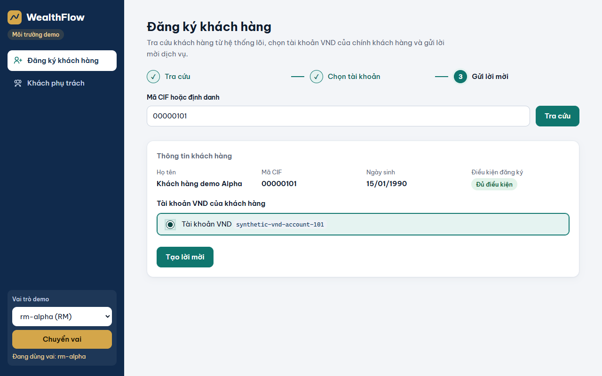
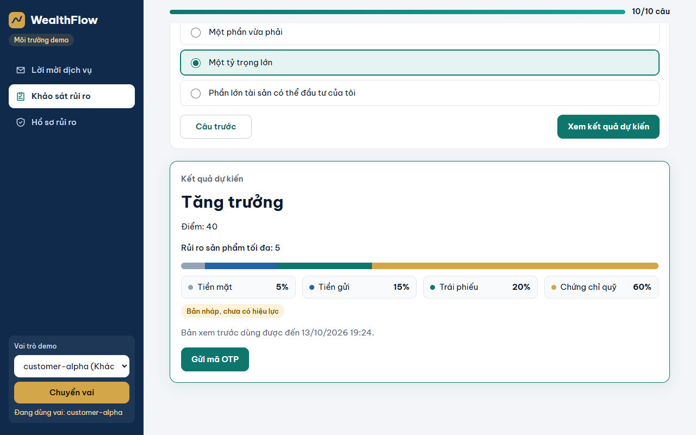
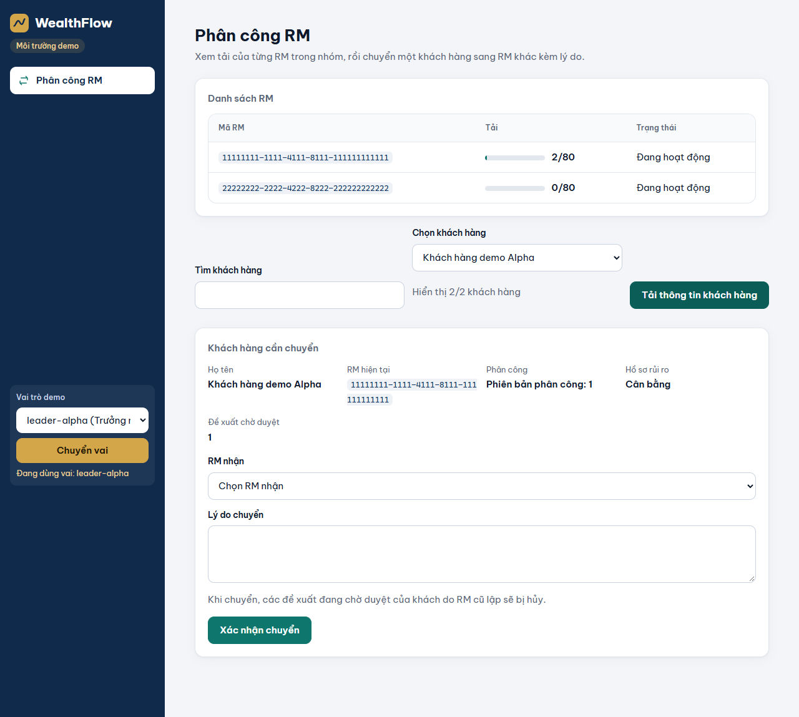
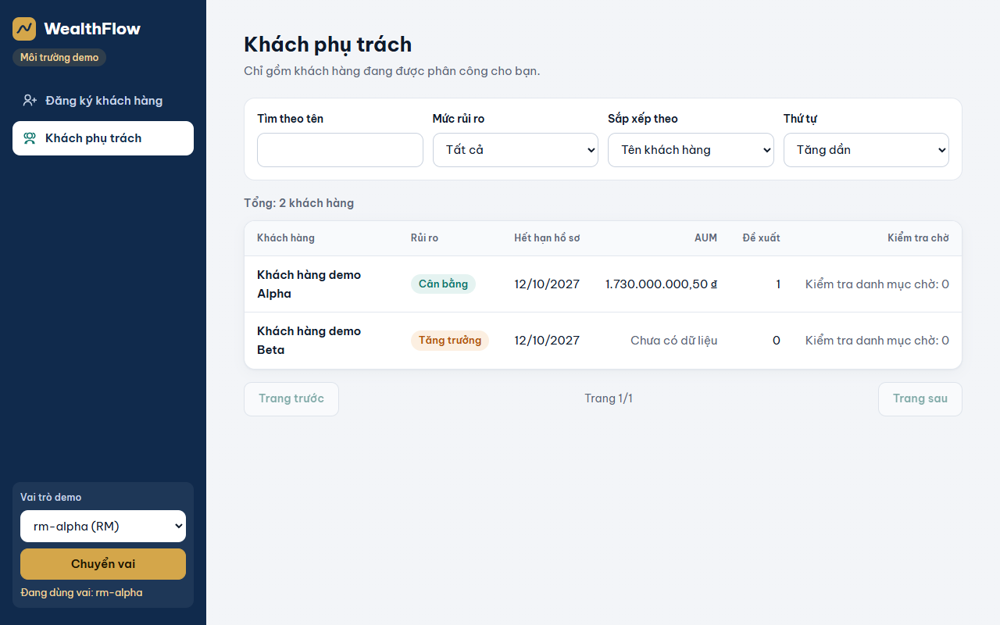
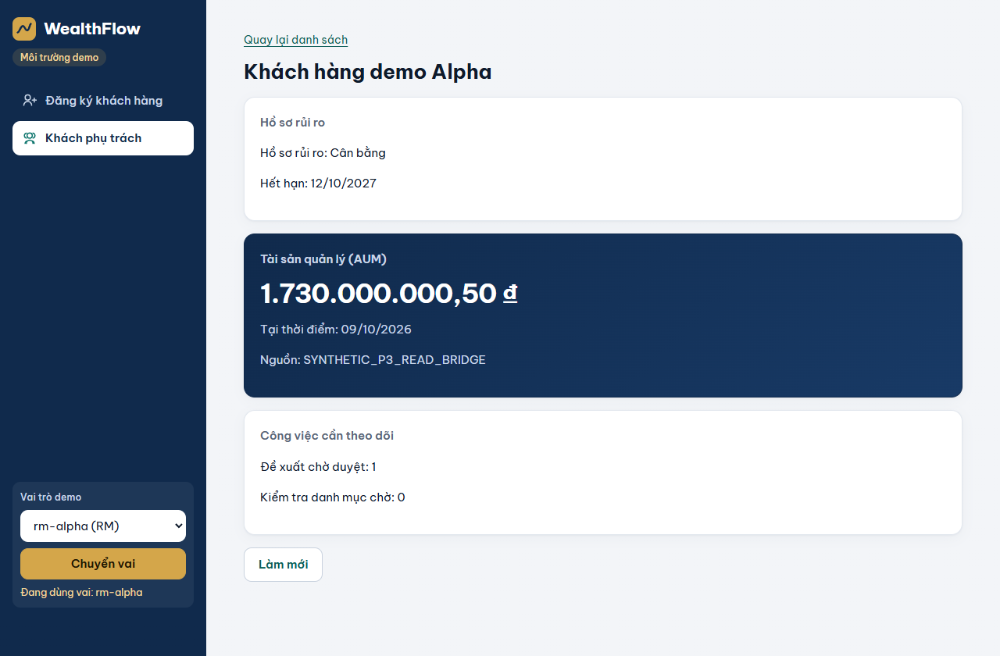
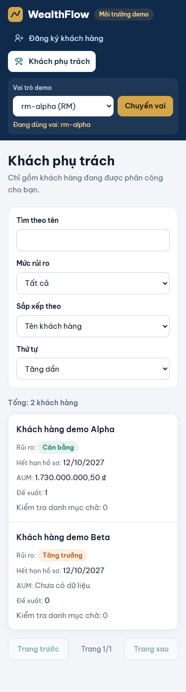
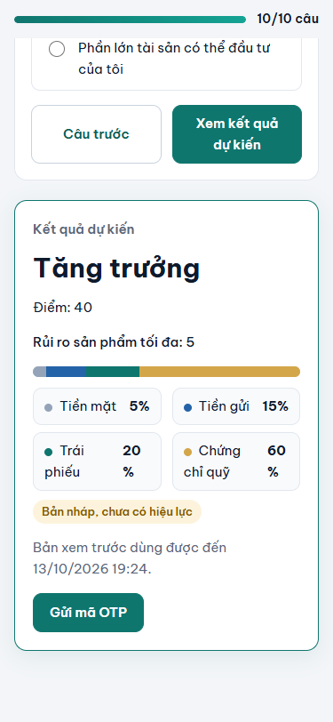
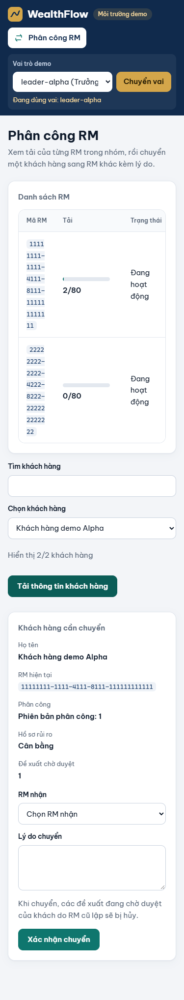
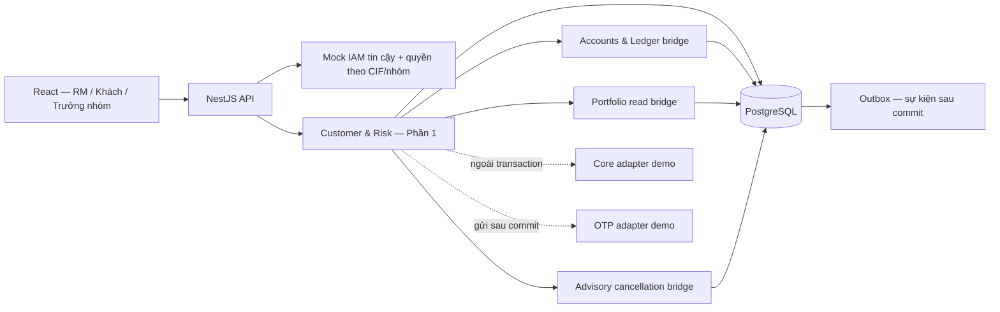

<div align="center">


# WealthFlow

**Đồ án Wealth Management • Source chung + Phần 1 (Customer & Risk)**

NestJS · React 19 · TypeScript · PostgreSQL · Playwright

[Phạm vi](#phạm-vi) · [Giao diện](#giao-diện) · [Chạy demo](#chạy-demo) · [Kiến trúc](#kiến-trúc) · [Kiểm tra](#kiểm-tra) · [Tài liệu](#tài-liệu)

</div>

> Mô hình ngân hàng mô phỏng phục vụ đồ án môn Phân tích thiết kế hệ thống thông tin nâng cao. Mọi dữ liệu demo là dữ liệu tổng hợp; Core banking, IAM và OTP là adapter mô phỏng. Không kết nối ngân hàng thật, không giao dịch tiền thật.

## Phạm vi

Repo dùng **một NestJS backend chia bốn module nghiệp vụ** và một ứng dụng React trong cùng monorepo (npm workspaces). Người dựng source phụ trách Phần 1; Phần 2–4 chỉ có các bridge tối thiểu để Phần 1 chạy và kiểm tra được.

| Phân công | Trách nhiệm | Trạng thái trong repo |
|---|---|---|
| **Phần 1 — Customer & Risk** | UC01 đăng ký dịch vụ · UC02 đánh giá rủi ro · UC03 phân công RM · UC04 danh sách khách của RM | ✅ Backend + giao diện + test |
| Phần 2 — Accounts & Ledger | Tài khoản đầu tư, nạp/rút, lịch sử, đáo hạn (UC05–08) | Bridge mở tài khoản VND số dư 0 |
| Phần 3 — Portfolio & Valuation | Sản phẩm, NAV, danh mục/AUM, drift (UC09–12) | Bridge đọc holdings có nguồn và thời điểm |
| Phần 4 — Advisory & Trading | Đề xuất, duyệt/từ chối, thực thi (UC13–16) | Bridge hủy proposal nguyên tử khi chuyển RM |

## Luồng Phần 1

1. **RM tra cứu khách (UC01):** Core mô phỏng trả CIF, điều kiện đăng ký và tài khoản VND chính chủ. Giao diện đi theo 3 bước (Tra cứu → Chọn tài khoản → Gửi lời mời); lời mời có hạn 72 giờ. Tra cứu có kiểm tra quyền theo phân công hiện tại; mỗi RM tra cứu tối đa 30 lần/phút và tạo tối đa 10 lời mời/phút.
2. **Khách đồng ý điều khoản (UC01):** khách đọc điều khoản, nhận OTP và tự nhập vào 6 ô (dán được cả mã, có đếm ngược gửi lại mã). Consent, dịch vụ, tài khoản số dư 0 và phân công RM được ghi trong cùng một transaction.
3. **Khách khảo sát rủi ro (UC02):** 10 câu hỏi tiếng Việt, hiện từng câu với nút Câu trước/Câu tiếp; server tính điểm và trả kết quả dự kiến kèm **mức rủi ro sản phẩm tối đa** và **phân bổ tài sản**. Chỉ khi xác nhận OTP mới tạo hồ sơ có hiệu lực 12 tháng và kích hoạt dịch vụ.
4. **Trưởng nhóm phân công (UC03):** chọn khách trong nhóm, xem tải từng RM (giới hạn 80 khách), chuyển RM kèm lý do sau hộp xác nhận nêu rõ tác động. Đề xuất đang chờ của RM cũ bị hủy trong cùng transaction và số lượng hủy do server trả về.
5. **RM theo dõi khách (UC04):** chỉ thấy khách đang phụ trách; lọc, sắp xếp, phân trang phía server. AUM, số lượt kiểm tra danh mục chờ và đề xuất chờ duyệt đều có `asOf`/nguồn; AUM chưa có dữ liệu hiển thị "Chưa có dữ liệu", không bao giờ là 0.

## Giao diện

Ảnh chụp từ ứng dụng chạy thật (seed CLI → NestJS API → Vite) với dữ liệu demo tổng hợp, trên Microsoft Edge.

| RM tra cứu và tạo lời mời (UC01) | Kết quả khảo sát dự kiến (UC02) |
|---|---|
|  |  |
| **Trưởng nhóm chuyển RM (UC03)** | **Danh sách khách của RM (UC04)** |
|  |  |

<details>
<summary>Chi tiết khách hàng và giao diện mobile (375px)</summary>

<p>

</p>
<p>



</p>
</details>

## Chạy demo

**Yêu cầu:** Node.js `24.20.0` (xem `.nvmrc`), PostgreSQL 15+ (Docker Compose hoặc bản cài sẵn), trình duyệt hiện đại.

```bash
npm ci
cp .env.example .env
```

Mở `.env`, tạo khóa ký token rồi dán vào `JWT_SECRET=`:

```bash
node -e "console.log(require('node:crypto').randomBytes(48).toString('base64url'))"
```

Khởi động PostgreSQL. Với Docker, dùng file compose có sẵn (thông tin đăng nhập chỉ dùng cho demo cục bộ):

```bash
docker compose -f infra/compose.yml up -d
```

Không dùng Docker thì trỏ `DATABASE_URL` trong `.env` tới một database PostgreSQL trống của bạn. Sau đó chạy migration + seed (chạy lại nhiều lần vẫn an toàn) và khởi động API:

```bash
npm run seed:demo
npm run start:api
```

API chạy ở `http://127.0.0.1:3000/api/v1` (kiểm tra: `GET /api/v1/health/ready`). Mở terminal khác để chạy giao diện:

```bash
npm run dev:web
```

Mở `http://127.0.0.1:5173`, chọn **Vai trò demo** rồi bấm **Chuyển vai**:

| Vai | Dùng để |
|---|---|
| `rm-alpha` (RM) | Tra cứu CIF `00000101` / `00000102`, tạo lời mời, xem khách phụ trách |
| `customer-alpha`, `customer-beta` (Khách) | Đồng ý điều khoản, khảo sát rủi ro, xem hồ sơ. Mã OTP xem ở nút **Xem hộp thư OTP demo** |
| `leader-alpha` (Trưởng nhóm) | Xem tải RM, chuyển khách giữa `rm-alpha` và `rm-beta` |

Mock auth, Core mô phỏng và hộp thư OTP demo **chỉ bật khi `NODE_ENV` là development/test và `MOCK_AUTH_ENABLED=true`**; cấu hình production kèm mock bị từ chối khi khởi động.

## Kiến trúc



```text
apps/api      NestJS: platform (auth, http, validation, transactions), modules/customer-risk, bridges P2–P4, migrations
apps/web      React 19 + Vite: hash routing, CSS thuần, không thư viện UI
scripts/      seed-demo.mjs — tạo actor demo, chạy migration
tests/api     Integration test trên PostgreSQL thật (Vitest)
tests/e2e     Playwright: hành trình UC01–04 trên desktop 1280px và mobile 375px
infra/        Docker Compose PostgreSQL 15 cho demo
docs/         Kế hoạch, đặc tả Phần 1, từ điển dữ liệu, hình ảnh
```

Một transaction nghiệp vụ dùng chung entity manager cho dữ liệu, audit và outbox. Khóa capacity/RM được lấy theo thứ tự thống nhất trước khóa khách. Core và gửi OTP không chạy khi đang giữ khóa dữ liệu.

## Quy tắc rủi ro

| Tổng điểm | Nhóm | Product risk tối đa | Tiền mặt / Tiền gửi / Trái phiếu / Chứng chỉ quỹ |
|---|---|---|---|
| 10–20 | Thận trọng | 2 | 10% / 50% / 30% / 10% |
| 21–35 | Cân bằng | 3 | 5% / 30% / 30% / 35% |
| 36–50 | Tăng trưởng | 5 | 5% / 15% / 20% / 60% |

Kết quả dự kiến không thay hồ sơ hiện hành. Lịch sử đã xác nhận là bất biến. Hạ mức rủi ro tạo một yêu cầu kiểm tra holdings/drift; hệ thống không tự bán tài sản. Hồ sơ hết hiệu lực đúng tại `expiresAt` (12 tháng lịch, điều chỉnh ngày cuối tháng, tính theo UTC; giao diện hiển thị giờ Việt Nam).

## Bảo vệ dữ liệu

- Token demo được ký và kiểm tra issuer, audience, hạn dùng. Actor, role, CIF và nhóm lấy từ registry tin cậy; xác thực luôn chạy trước khi gọi Core.
- Mọi API kiểm tra quyền phía server, không dựa vào việc ẩn nút trên giao diện. Chuyển RM có hiệu lực ngay ở lần truy cập tiếp theo.
- OTP dùng một lần, có thời hạn, gắn actor/mục đích/thao tác; database chỉ lưu hash có salt.
- `Idempotency-Key` gắn actor, mục đích, resource và payload: retry đúng trả lại kết quả cũ, đổi payload với cùng key bị từ chối.
- Audit lưu metadata và before/after đã lọc, không lưu token hay mã OTP. Token phía trình duyệt chỉ giữ trong bộ nhớ.
- Tiền luôn là chuỗi thập phân từ database tới giao diện, không tính toán bằng số thực JavaScript.

## Kiểm tra

| Lệnh | Nội dung | Kết quả gần nhất |
|---|---|---|
| `npm run test:api` | 77 integration test (11 file) trên PostgreSQL thật: rollback, ràng buộc unique, OTP, cạnh tranh đồng thời, phân quyền, giới hạn tần suất, log | 77/77 pass |
| `npm run test:e2e` | 14 hành trình × desktop + mobile trên Edge, với seed CLI, API và Vite thật | 26 pass, 2 skip (test bố cục chỉ chạy ở một kích thước màn hình) |
| `npm run lint` · `npm run typecheck` · `npm run build` | oxlint, TypeScript, build API + web | sạch |

Test cần biến môi trường `WMS_TEST_POSTGRES_ADMIN_URL` trỏ tới một PostgreSQL có quyền tạo database; mỗi lần chạy tạo database riêng rồi xóa. Ví dụ với PostgreSQL cục bộ:

```bash
export WMS_TEST_POSTGRES_ADMIN_URL=postgresql://<user>:<password>@127.0.0.1:5432/postgres
npm run test:api
npm run test:e2e   # dùng Microsoft Edge cài sẵn (channel msedge); cần cổng 3000 và 5173 trống
```

GitHub Actions (`.github/workflows/ci.yml`) chạy build, lint, typecheck và test API trên PostgreSQL 15 cho mỗi push và pull request.

## Giới hạn đã biết

- Bộ câu hỏi khảo sát được lưu theo phiên bản: phiên bản tiếng Việt `demo-risk-v2-vi` đang dùng, phiên bản đầu `demo-risk-v1` (tiếng Anh) được giữ nguyên ở trạng thái ngừng dùng cho lịch sử. Bản nháp làm trên phiên bản đã ngừng không xác nhận được.
- "Kiểm tra danh mục chờ" là số yêu cầu kiểm tra holdings đang mở do hạ mức rủi ro; engine định giá và drift đầy đủ thuộc Phần 3.
- Danh sách RM hiển thị mã RM vì registry demo không có tên hiển thị.
- Giới hạn tần suất (cấu hình bằng `LOOKUP_RATE_LIMIT_PER_MINUTE`, `INVITE_RATE_LIMIT_PER_MINUTE`, mặc định 30 và 10) được giữ trong bộ nhớ của một tiến trình API.
- Mock IAM/OTP chỉ phục vụ demo, chưa phải cơ chế đủ điều kiện triển khai ngân hàng thật.

## Tài liệu

- [Kế hoạch triển khai đã duyệt](docs/planning/implementation-plan.vi.md)
- [Tổng quan và phân công](docs/part1/01-overview.vi.md)
- [Đặc tả UC01–04 và sơ đồ UC tổng thể](docs/part1/02-use-cases.vi.md)
- [Trình tự xác nhận rủi ro](docs/part1/03-risk-sequence.vi.md)
- [Từ điển dữ liệu](docs/part1/04-data-dictionary.vi.md)

Tài liệu gốc DOCX/HTML của môn học và thông tin cá nhân không được đưa vào repo.

## Phát triển theo nhóm

Mỗi người làm trong module được phân công và dùng shared contract thay vì gọi trực tiếp service nội bộ của module khác. Thay đổi schema bằng migration mới, không sửa migration cũ. Khi thêm nghiệp vụ liên quan quyền truy cập, OTP hoặc giao dịch dữ liệu, viết test hành vi và test cạnh tranh trước rồi mới triển khai.

API, cấu trúc dữ liệu và nội dung khảo sát trong repo phục vụ đồ án; nhóm cần thống nhất và giảng viên xem xét trước khi mở rộng.
