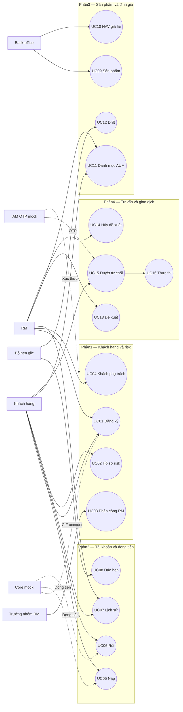

# Đặc tả Use Case — Phần 1

Baseline: mô hìnhA trong [kế hoạch đã duyệt](../planning/implementation-plan.vi.md). Bản đặc tả mô tả yêu cầu; kết quả hiện thực/kiểm thử nằm ở tài liệu verification của repo, không suy ra từ bảng dưới.

> Đánh số quy tắc nghiệp vụ (BR) trong tài liệu này theo "Danh mục 25 quy tắc nghiệp vụ" của Tài liệu đặc tả WMS bản 18/10/2026. Quy tắc riêng của Phần 1 dùng mã BR-P1-xx. Bản đặc tả chi tiết kèm sơ đồ nằm trong báo cáo Phân hệ 1 của nhóm.

## Tác nhân và tiền điều kiện chung

Customer, RM và LEADER (trưởng nhóm) là vai trò của IAM demo hiện tại; Back-office thuộc các phân hệ tiếp theo. Actor lấy từ IAM đã xác thực; client không tự cấp role/CIF/team. Core Banking mock cung cấp CIF, KYC, trạng thái và tài khoản thanh toán. OTP mock cung cấp challenge/receipt được gắn với tác nhân, thao tác và nội dung bất biến. Mọi mutation có audit; truy cập sai quyền bị từ chối và ghi nhận phù hợp.

## UC01 — Đăng ký dịch vụ

| Thuộc tính | Nội dung |
|---|---|
| Tác nhân | RM khởi tạo; Customer chấp nhận; Core/IAM mock hỗ trợ |
| Kích hoạt | Khách đồng ý đăng ký sau tư vấn |
| Tiền điều kiện | CIF hoạt động, KYC, đủ18 tuổi, ít nhất một tài khoản VND chính chủ |
| Thành công | Request đã chấp nhận; consent có version; investment account số dư0; service chờ đánh giá risk; initiatingRM là RM tạm |
| Thất bại | Không có account/service/consent được tạo nửa chừng |

Luồng: RM lookup CIF/ID → server kiểm tra eligibility → RM chọn account → tạo request giữ suất capacity → Customer đọc terms/version → challenge OTP gắn request/purpose/hash → confirm → transaction mở account, consent, assignment tạm và service → outbox thông báo.

Ngoại lệ: CIF không có/phong tỏa/chưa KYC, dưới18, thiếu VND, chọn account người khác; CIF có service/request mở; Core timeout; OTP sai/hết hạn/replay; đúng mốc72h; bootstrap account lỗi. Retry cùng idempotency key/nội dung trả cùng kết quả; cùng key khác nội dung bị conflict. Request quá hạn có thể được thay bằng request mới, không tạo account thứ hai.

BR (đánh số theo đặc tả WMS 18/10): BR-01 audit, BR-02 điều kiện đăng ký, BR-03 ký Smart OTP; BR-P1-01 mỗi CIF một dịch vụ/lời mời, BR-P1-02 lời mời 72 giờ; hạn mức BR-07 tính cả chỗ giữ để onboarding không làm vượt 80. Tuổi theo ngày sinh/ngày nghiệp vụ; không xấp xỉ bằng số ngày365.

## UC02 — Đánh giá khẩu vị rủi ro

| Thuộc tính | Nội dung |
|---|---|
| Tác nhân | Customer chính chủ; IAM/OTP mock |
| Kích hoạt | Sau đăng ký, hết hạn12 tháng hoặc khách tự yêu cầu đánh giá lại |
| Tiền điều kiện | Dịch vụ đã đăng ký, quyền chính chủ |
| Thành công | Profile mới confirmed, current pointer chuyển nguyên tử, lịch sử cũ giữ nguyên; kích hoạt service lần đầu |
| Không xác nhận | Preview/bỏ dở/OTP sai không làm thay đổi profile có hiệu lực |

Luồng: lấy questionnaire version → trả lời10 câu duy nhất → server tính score → lưu draft tạm và preview allocation → customer xác nhận OTP đúng draft/hash/version → transaction consume receipt, append profile, đổi pointer/activate service, audit/outbox.

| Điểm | Nhóm | Risk sản phẩm tối đa | Cash / Deposit / Bond / Fund |
|---:|---|---:|---|
|10–20|CONSERVATIVE|2|10 /50 /30 /10 %|
|21–35|BALANCED|3|5 /30 /30 /35 %|
|36–50|GROWTH|5|5 /15 /20 /60 %|

Mỗi câu có5 mức điểm1–5. Server tra điểm từ option của questionnaire đã version, không tin category/score/maxRisk client gửi. Draft có nội dung bất biến. Sửa câu trả lời tạo draft mới; challenge của draft cũ không thể xác nhận nội dung đã sửa. Hai draft dựa trên cùng profile version không được ghi đè nhau âm thầm.

Hồ sơ có hiệu lực12 tháng lịch từ confirmation; mốc hết hạn loại trừ (now>=expiresAt là expired). Policy ngày cuối tháng/năm nhuận bám quyết định trong plan. Khi giảm risk: giữ nguyên holdings, thông báo RM các holdings vượt mức mới và kích hoạt đánh giá drift qua outbox; không tự bán hoặc sửa ledger.

BR (đánh số 18/10): BR-01 audit, BR-03 ký Smart OTP, BR-04 đủ 10 câu, BR-05 chấm điểm, BR-06 hiệu lực 12 tháng, BR-P1-03 bộ câu hỏi có phiên bản; consumerP4 dùng risk snapshot/version/validAt, không chỉ một label.

## UC03 — Phân công/chuyển RM

| Thuộc tính | Nội dung |
|---|---|
| Tác nhân | LEADER (trưởng nhóm) trong đúng phạm vi nhóm |
| Tiền điều kiện | Service hoạt động; targetRM active và trong nhóm; request có expected assignment version |
| Thành công | Đúng1 assignment hiện hành; history preserved; oldRM mất quyền; pending proposal cũ bị hủy nguyên tử |
| Thất bại | Assignment/proposal giữ nguyên nếu capacity, quyền hoặc cancellation thất bại |

Luồng: chọn khách → đọc capacity → chọn RM + reason/version → khóa capacity theo thứ tự ổn định, khóa customer → recheck quyền/state/version/slot → đóng old assignment, tạo mới, hủy proposal pending của oldRM trong cùng transaction → audit/outbox → thông báo sau commit.

Capacity gồm assignment hiện hành và reservation onboarding còn hiệu lực, tối đa80. Số hiển thị ở form không thay thế việc kiểm tra lại dưới DB lock. Cùng targetRM là no-op, không hủy proposal hoặc tạo assignment history giả. Hai leader chuyển cùng khách dùng optimistic version và DB lock; luôn đúng1RM hiện hành.

Race với approval: consumerP4 dùng cùng customer lock và recheck currentRM. Nếu transfer commit trước, proposal cũ cancelled và không thể execute. Nếu proposal đã terminal trước, transfer không đổi terminal. P1 không tạo engine giao dịch tài chính thayP4.

BR (đánh số 18/10): BR-01 audit, BR-07 hạn mức 80, BR-08 phạm vi dữ liệu, BR-P1-04 chuyển RM hủy đề xuất chờ của RM cũ; terminal-preservation contract theo BR-25.

## UC04 — Danh sách khách phụ trách

| Thuộc tính | Nội dung |
|---|---|
| Tác nhân | CurrentRM; leader/customer dùng detail riêng theo quyền |
| Kích hoạt | RM tra cứu đầu ngày hoặc tìm khách |
| Thành công | List/paging/filter/sort đúng scope, detail không lộ dữ liệu khách ngoài scope |
| Dữ liệu | Tên, risk, hạn review, AUM, drift mở, proposal pending; summary có asOf/provenance |

Luồng: auth context xác địnhRM → query current assignments → lọc/phân trang ổn định → batch summaryP3/P4 chỉ cho IDs được phép → trả response → RM xem detail với access check lần nữa.

Thiếu summary được đánh dấu unavailable, không coi là0. Snapshot seed phải có nhãn demo; summary không đồng nghĩa engineP3 hoàn chỉnh. Sorting theoAUM chỉ được mở nếu query/projection hỗ trợ sort toàn tập trước paging, không sort riêng một trang rồi tuyên bố sort toàn danh sách.

Ngoại lệ: URL detail của khách không phụ trách, oldRM sau chuyển, tampered actor/role/CIF, vượt scope nhóm, filter/sort không được phép. Backend từ chối dù React có thể ẩn menu. BR01 cho audit truy cập bị chặn; BR08 cho ownership.

## Sơ đồ Use Case tổng thể

Phần1 là phần hiện thực của thành viên1; UC05–16 dưới đây thể hiện hệ thống đồ án đầy đủ và ownership tương lai, không khẳng định đã hiện thực trong repo này.

