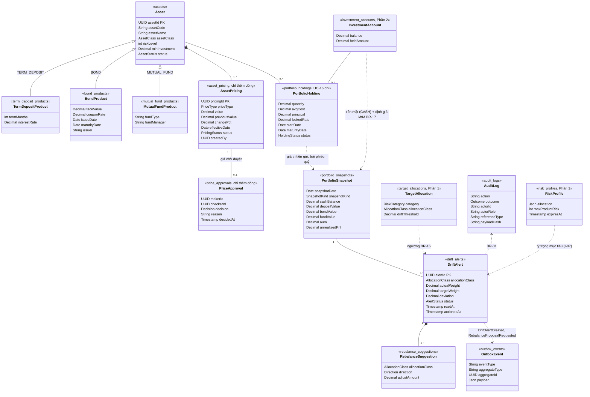

# Phần 3: Sản phẩm và Định giá danh mục

Hiện thực UC-09 (danh mục sản phẩm), UC-10 (giá, NAV, lãi suất), UC-11 (xem danh mục và định giá Mark-to-Market) và UC-12 (cảnh báo lệch tỷ trọng, kèm yêu cầu đề xuất tái cân bằng). Mã nguồn ở `apps/api/src/modules/portfolio-valuation/`, giao diện ở `apps/web/src/pages/Products.tsx`, `Prices.tsx`, `PriceApprovals.tsx`, `Portfolio.tsx`, `DriftAlerts.tsx`.

## Khác với DDL của nhóm

Có một thay đổi, ở migration `009`: thêm `portfolio_snapshots.snapshot_kind` (`DAILY` hoặc `EVENT`, mặc định `DAILY`) và thay `UNIQUE (customer_id, snapshot_date)` bằng unique một phần chỉ áp cho `DAILY`.

Lý do: UC-12 quét cả sau UC-10, UC-08, UC-02, mà mỗi cảnh báo phải trỏ tới một snapshot; nếu một khách chỉ có một snapshot mỗi ngày thì lần chụp 17:00 sẽ không còn chỗ. `tests/api/s19-wms-schema.spec.ts` và `s21-team-seed.spec.ts` khai báo đúng cột và constraint này là ngoại lệ, phần còn lại vẫn khóa theo DDL.

## Quyết định

Các điểm đặc tả mâu thuẫn, không nói rõ, hoặc nhóm chọn cách hiện thực khác. Mỗi dòng đều đảo ngược được bằng một thay đổi mã và test.

| Vấn đề | Chọn | Lý do |
|---|---|---|
| Ngưỡng lệch: `>= 5` hay `> 5` | `>= 5` điểm phần trăm, so sau khi làm tròn 2 chữ số | BR-16, quy trình 3d và `CHECK` của schema; UC-12 bước 3 viết "quá 5%" nhưng bước kiểm tra tự động viết "đạt hoặc vượt" |
| Quy tắc 20% có áp cho lãi suất không (D-R10-3) | Có, cho cả NAV, giá trái phiếu và lãi suất | FR-10 và quy trình 3b; BR-15 chỉ nêu NAV và giá trái phiếu. Giữ nguyên để lãi suất nhập nhầm cũng cần người thứ hai |
| Mức rủi ro "nằm trong khoảng cho phép của loại sản phẩm" (D-R10-2) | Chỉ kiểm mức từ 1 đến 5 (BR-14, `CHECK` của schema) | UC-09 bước 4 không nêu khoảng cho từng loại; không bịa ràng buộc. Nếu nhóm đưa khoảng cụ thể, thêm vào `assertClassFields` và một test |
| "RM nhận thông báo" (D-R10-5) | Không thêm bảng; mỗi cảnh báo mới ghi một sự kiện outbox `DriftAlertCreated` cùng transaction với cảnh báo, và RM nhận qua màn `Cảnh báo lệch` | DDL của nhóm chỉ có `customer_notifications` (kiểu `RISK_SURVEY_REMINDER`), không có thông báo cho nhân viên; thêm bảng nghĩa là lệch DDL lần nữa. Dịch vụ thông báo thật (Notification Service) sẽ tiêu thụ sự kiện |
| `HoldingsMutationPort` cho UC-16 (D-R10-7) | Chưa làm | Ghi `portfolio_holdings` chỉ thuộc UC-16 (Phần 4), cần chung transaction với sổ cái; để cho phần tích hợp Phần 4 |
| Tên action audit (D-R10-1) | Giữ tên của mã, có bảng ánh xạ bên dưới | Đổi tên làm đổi dữ liệu audit đã ghi và các test s28, s29 |
| Giao tiếp I-05 (P1 → P3 bằng sự kiện) | Quét lệch gọi trực tiếp sau commit; sự kiện `RiskHoldingsCheckRequested` giữ nguyên cho việc RM kiểm tra | `published_at` rỗng đang có nghĩa "RM chưa kiểm tra", tiêu thụ sự kiện sẽ làm sai `Kiểm tra danh mục chờ` |
| Lỗi truy cập `NOT_YOUR_CUSTOMER` | Giữ `403 FORBIDDEN` và audit `DENIED` | Thống nhất với P1, P2 |
| Mã lỗi `VALIDATION_FAILED` | Giữ `VALIDATION_ERROR` | Mã chung của `StrictBodyPipe` |
| Id giá không tồn tại khi duyệt (D-R10-6) | `404 PRICE_NOT_FOUND`; giá có thật nhưng không còn chờ duyệt vẫn là `409 PRICE_NOT_PENDING` | Phân biệt "sai id" với "đã xử lý rồi" |
| Maker = Checker | `403 MAKER_CHECKER_VIOLATION` và một dòng audit `DENIED` (`PRICE_DECISION`) | AGENTS.md: truy cập bị từ chối phải được audit; giao dịch đã rollback nên dòng này ghi ở transaction ngắn riêng, chỉ có mã lỗi |
| Ngày hiệu lực của giá | Không ở tương lai; cùng ngày với giá trước thì được và dòng nhập sau thắng; lùi về trước giá mới nhất là `409 PRICE_NOT_LATEST` | `PRICE_NOT_LATEST` là quy tắc thêm, đặc tả không nêu; `v_asset_latest_price` phân thắng bại cùng ngày bằng `created_at` |
| Nhập giá cho sản phẩm `DISCONTINUED` | Được nhận và vẫn tính lại giá trị cho người đang giữ | Ngừng bán chỉ ẩn khỏi giỏ mới, khoản đang giữ vẫn cần giá (UC-09) |
| Giá đầu tiên của sản phẩm | `previousValue` và `changePct` là `null`, áp dụng ngay | Không có giá để so sánh nên không có biên độ (trigger của nhóm cũng để `NULL`) |
| Trái phiếu đáo hạn đúng hôm nay | Được thêm (so với ngày Việt Nam); đã qua thì `400 BOND_MATURITY_PASSED` | Spec: "không ở quá khứ". Trigger của nhóm so với `CURRENT_DATE` của PostgreSQL nên `SET LOCAL TIME ZONE 'Asia/Ho_Chi_Minh'` |
| Tỷ trọng mục tiêu lấy từ đâu | `risk_profiles.allocation` của hồ sơ hiện hành; ngưỡng từ `target_allocations.drift_threshold` | Đặc tả mục quan hệ 8 |
| Đề xuất tái cân bằng thuộc ai (D-R10-4) | Phần 3 làm endpoint, đặt `ACTIONED`, ghi sự kiện `RebalanceProposalRequested`; Phần 4 (UC-13) tiêu thụ sự kiện sau | Đặc tả: RM chọn nút này thì `DriftAlert.status` thành `ACTIONED` |

### Ánh xạ tên action audit

| Tên trong đặc tả (mục 2236) | Tên trong mã | Ghi chú |
|---|---|---|
| `CREATE_ASSET` | `ASSET_CREATED` | |
| `CHANGE_ASSET_STATUS` | `ASSET_STATUS_CHANGED` | Đổi sang cùng trạng thái vẫn ghi dòng audit |
| `CHANGE_RISK_LEVEL` | `ASSET_RISK_CHANGED` | |
| `INSERT_PRICE` | `PRICE_SUBMITTED` | Import CSV ghi thêm `PRICE_IMPORTED` |
| `APPROVE_PRICE` | `PRICE_APPROVED` | |
| `REJECT_PRICE` | `PRICE_REJECTED` | |
| `CREATE_DRIFT_ALERT` | `DRIFT_ALERTS_CHANGED` | Một dòng cho mỗi khách mỗi lượt quét, ghi cả cảnh báo tạo mới và đã `RESOLVED`; mỗi cảnh báo mới còn có sự kiện outbox `DriftAlertCreated`. Actor là `SYSTEM_JOB` |
| không có | `PORTFOLIO_VIEW` | RM, Trưởng nhóm xem danh mục (`SUCCESS`), hoặc bị từ chối (`DENIED`) |
| không có | `PORTFOLIO_SNAPSHOT_COMPLETED` | Mỗi lượt chạy job (17:00 hoặc nút demo) có snapshot mới hoặc có khách lỗi |
| không có | `DRIFT_ALERT_ACTIONED` | RM tạo đề xuất tái cân bằng (`SUCCESS`), hoặc RM không phụ trách bị từ chối (`DENIED`) |
| không có | `DRIFT_ALERT_READ` | Chỉ ghi khi bị từ chối (`DENIED`) |
| không có | `PRICE_DECISION` | Chỉ ghi khi Maker = Checker (`DENIED`) |

## Sơ đồ lớp

Tên theo bảng thật trong schema `wms`. `PortfolioHolding` do Phần 4 (UC-16) ghi; Phần 3 chỉ đọc. Tiền mặt không phải sản phẩm: lấy từ tài khoản đầu tư của Phần 2 (`v_account_balance`), và là nhóm `CASH` thứ tư khi tính tỷ trọng.

Nhóm tài sản khi tính tỷ trọng: `CASH`, `TERM_DEPOSIT`, `BOND`, `MUTUAL_FUND`. `RebalanceSuggestion` có tối đa một dòng cho mỗi cảnh báo (nhóm tài sản của chính cảnh báo đó).

## Định giá (BR-17)

Tính khi xem, không ghi dữ liệu. P3 không ghi `portfolio_holdings` vì bảng này chỉ UC-16 được cập nhật, nên cột `accrued_interest` không được dùng.

| Lớp | Giá trị | Giá vốn |
|---|---|---|
| Tiền gửi | gốc + `floor(gốc × locked_rate × số ngày đã gửi / 36500)`, tối đa đến ngày đáo hạn | gốc |
| Trái phiếu | số lượng × giá tham chiếu mới nhất | số lượng × `avg_cost` |
| Chứng chỉ quỹ | số lượng × NAV mới nhất | số lượng × `avg_cost` |

- AUM = tiền mặt khả dụng + giá trị các khoản trên. Tiền và tỷ trọng tính bằng BigInt, không dùng số thực.
- Lãi/lỗ chưa thực hiện = giá trị − giá vốn của từng khoản, có thể âm (giá thấp hơn giá vốn); tổng cộng các khoản.
- Giá chờ duyệt hoặc bị từ chối không được dùng, nhờ view `v_asset_latest_price`.
- Giá cũ hơn 3 ngày làm việc (thứ Hai đến thứ Sáu, chưa tính ngày lễ) được gắn nhãn, không bị từ chối.
- Sản phẩm chưa có giá: giá trị `null`, không tính vào AUM, danh mục là `INCOMPLETE`, và lượt quét bỏ qua khách này.
- Trái phiếu đã đáo hạn vẫn được định giá bằng giá cuối cho đến khi Phần 4 đóng khoản nắm giữ.

## Duyệt giá (BR-15)

`asset_pricing` và `price_approvals` chỉ cho thêm dòng. Biến động trên 20% thì dòng giá có trạng thái `PENDING_APPROVAL`; quyết định là một dòng mới trong `price_approvals`, còn trạng thái dòng giá không đổi (seed của nhóm cũng làm vậy). Chỉ `BACK_OFFICE_MANAGER` được duyệt, và không được duyệt giá do chính mình nhập. Mỗi sản phẩm có tối đa một giá chờ duyệt.

Biên độ so sau khi làm tròn 4 chữ số thập phân, giống trigger của nhóm: đúng 20,0000% và 20,00004% (làm tròn thành 20,0000) được áp dụng ngay, 20,00005% (làm tròn thành 20,0001) chờ duyệt.

## Quét lệch (UC-12)

`DriftScanner.scanCustomer` dùng chung cho mọi nguồn, mỗi khách một transaction. Lỗi khi quét sau một nghiệp vụ chỉ ghi log, không làm hỏng nghiệp vụ đó; job 17:00 sẽ làm bù.

| Nguồn | Khách được quét | Snapshot |
|---|---|---|
| Job, sau 17:00 giờ Việt Nam | Dịch vụ `ACTIVE`, chưa có `DAILY` của ngày | `DAILY` |
| UC-10, giá có hiệu lực (trừ lãi suất) | Đang giữ sản phẩm đó | Luôn ghi `EVENT` |
| UC-08, sau lượt tất toán | Tài khoản vừa được tất toán | `EVENT` khi có cảnh báo cần tạo |
| UC-02, sau xác nhận hồ sơ | Khách đó | `EVENT` khi có cảnh báo cần tạo |

- Chỉ tạo cảnh báo khi AUM khác 0, hồ sơ rủi ro còn hiệu lực và có RM phụ trách. Khách hồ sơ hết hạn vẫn có snapshot.
- Mỗi cặp khách và nhóm tài sản có một cảnh báo đang mở: số đổi thì `RESOLVED` và tạo mới, hết lệch thì `RESOLVED`. Cảnh báo `ACTIONED` được giữ nguyên, lượt quét không đụng tới và không tạo cảnh báo mới cho nhóm đó.
- Mỗi cảnh báo tạo mới (kể cả bản thay thế vì số đổi, không kể lần làm mới cùng số) ghi sự kiện outbox `DriftAlertCreated` `{alertId, customerId, rmId, allocationClass, deviation}` trong cùng transaction với cảnh báo. Nếu ghi sự kiện lỗi thì cả cảnh báo và snapshot của lượt quét đó không được lưu, lần quét sau làm bù.
- Gợi ý là số tiền đưa nhóm về đúng mục tiêu: `|giá trị − mục tiêu × AUM / 100|`. Hệ thống không tự đặt lệnh.
- Danh sách cảnh báo của RM đi theo phân công hiện hành, không theo `rm_id` trên cảnh báo.
- Cảnh báo sản phẩm vượt mức rủi ro (UC-09) tính khi xem, nên tự hết khi không còn vượt mức.

### Tạo đề xuất tái cân bằng (UC-12 bước 5)

`POST /rm/drift-alerts/:id/rebalance-proposal`, chỉ RM đang phụ trách khách của cảnh báo. Trong một transaction: khóa dòng cảnh báo, đặt `status = ACTIONED` và `actioned_at`, ghi audit `DRIFT_ALERT_ACTIONED` và sự kiện outbox `RebalanceProposalRequested` (`aggregate_type = DRIFT_ALERT`) với `{alertId, customerId, rmId, riskProfileId, allocationClass, actualWeight, targetWeight, suggestions[]}`. Phần 3 không tạo đề xuất và không đặt lệnh: Phần 4 (UC-13) tiêu thụ sự kiện.

- Cần `Idempotency-Key`; gửi lại cùng khóa trả đúng kết quả đã lưu, không thêm sự kiện hay dòng audit.
- Cảnh báo `NEW` hoặc `READ` mới được tạo đề xuất. Cảnh báo đã `ACTIONED` hoặc `RESOLVED` trả `409 ALERT_NOT_OPEN`; id không có trả `404 ALERT_NOT_FOUND`.
- RM không phụ trách khách đó nhận `403 FORBIDDEN` và một dòng audit `DENIED`. Trưởng nhóm, Back-office, Khách nhận `403` từ lớp phân quyền theo vai (không audit, như các endpoint khác của repo).
- Giao diện: nút `Tạo đề xuất tái cân bằng` trên từng thẻ ở màn `Cảnh báo lệch`; sau khi tạo, thẻ rời danh sách đang mở và dòng trạng thái ghi `Đã tạo đề xuất tái cân bằng: <khách>, <nhóm tài sản>`.

## API (tiền tố `/api/v1`)

Mọi lệnh `POST` và `PATCH` nghiệp vụ cần `Idempotency-Key`. Tiền và giá là chuỗi decimal.

| Vai trò | Endpoint | Ghi chú |
|---|---|---|
| Back-office | `GET /back-office/assets`, `GET .../:id` | Lọc `assetClass`, `status`, `q`; chi tiết có lịch sử giá |
| Back-office | `POST /back-office/assets` | Bản ghi cha, bản ghi con và giá khởi tạo trong một transaction |
| Back-office | `PATCH .../assets/:id/status`, `.../risk-level` | |
| Back-office | `POST /back-office/prices` | Trả giá cũ, mới, `changePct`, `status`, `scan` |
| Back-office | `POST /back-office/prices/import` | Body `csv`, cột `assetCode,value,effectiveDate`, tối đa 500 dòng; trả kết quả từng dòng |
| Back-office, Quản lý | `GET /back-office/prices/pending` | |
| Quản lý | `POST /back-office/prices/:id/approve`, `.../reject` | Body `reason`; `404 PRICE_NOT_FOUND`, `409 PRICE_NOT_PENDING`, `403 MAKER_CHECKER_VIOLATION` (audit `DENIED`) |
| RM, Trưởng nhóm | `GET /products` | Sản phẩm đang bán |
| Khách | `GET /me/portfolio`, `GET /me/portfolio/aum-history` | Lịch sử có `days`, mặc định 90, tối đa 365 |
| RM, Trưởng nhóm | `GET /customers/:id/portfolio`, `.../aum-history`, `.../drift-alerts` | Theo phân công hiện hành; mỗi lượt xem ghi audit |
| RM | `GET /rm/drift-alerts`, `POST /rm/drift-alerts/:id/read` | Cảnh báo có thêm `actionedAt` (null nếu chưa tạo đề xuất) |
| RM | `POST /rm/drift-alerts/:id/rebalance-proposal` | Đặt `ACTIONED`, ghi sự kiện `RebalanceProposalRequested`; `404 ALERT_NOT_FOUND`, `409 ALERT_NOT_OPEN` |
| RM | `GET /rm/product-risk-warnings` | |
| Back-office, chỉ khi mock | `POST /demo/jobs/portfolio-snapshot` | Body có `asOf` tùy chọn |

Mã lỗi riêng: `PRODUCT_CODE_EXISTS`, `BOND_MATURITY_PASSED`, `ASSET_NOT_FOUND`, `PRICE_PENDING_EXISTS`, `PRICE_NOT_LATEST`, `PRICE_NOT_PENDING`, `PRICE_NOT_FOUND`, `MAKER_CHECKER_VIOLATION`, `ALERT_NOT_FOUND`, `ALERT_NOT_OPEN`, `ACCOUNT_NOT_FOUND`, `JOB_RUNNING`.

Sự kiện outbox do Phần 3 ghi (`published_at` rỗng cho đến khi có bên tiêu thụ): `DriftAlertCreated` và `RebalanceProposalRequested`, cùng `aggregate_type = DRIFT_ALERT`, `aggregate_id` là `alertId`.

## Bảng test case TC-P3

Đặc tả chỉ có TC-P1; TC-P3 dưới đây do nhóm tự định nghĩa từ UC-09 đến UC-12 và BR-14 đến BR-17, ánh xạ tới test hiện có. Test API ở `tests/api/` (PostgreSQL thật), test giao diện ở `tests/e2e/uc13-portfolio.spec.ts` (desktop 1280px và mobile 375px).

| Mã | Quy tắc | Tình huống | Kết quả mong đợi | Test |
|---|---|---|---|---|
| TC-P3-01 | UC-09 | Thêm tiền gửi, trái phiếu, quỹ | Bản ghi cha, bản ghi con, giá khởi tạo, audit trong một transaction; `ON_SALE` | s28 `creates a %s with its child row…` (3 lớp) |
| TC-P3-02 | UC-09 | Mã sản phẩm trùng | `409 PRODUCT_CODE_EXISTS`, không có dòng thứ hai | s28 `a duplicate code is 409…` |
| TC-P3-03 | UC-09 | Trái phiếu đáo hạn trong quá khứ | `400 BOND_MATURITY_PASSED`, không lưu gì | s28 `a bond maturing in the past…` |
| TC-P3-04 | UC-09 | Trái phiếu đáo hạn đúng hôm nay | Được thêm; định giá bằng giá cuối | s32 `a bond maturing today…` |
| TC-P3-05 | BR-14 | Mức rủi ro 0, 6, 2.5; thiếu hoặc thừa trường theo lớp; tiền dạng số thực | `400 VALIDATION_ERROR` | s28 `%s is 400 VALIDATION_ERROR` |
| TC-P3-06 | NFR idempotency | Gửi lại cùng khóa; cùng khóa khác nội dung | Trả kết quả đã lưu; `409 IDEMPOTENCY_CONFLICT` | s28 `a replay returns the stored result…`, s29 `a replay returns the stored result…` |
| TC-P3-07 | BR phân quyền | Quản lý, RM, Khách gọi API sản phẩm | `403 FORBIDDEN` | s28 `only BACK_OFFICE manages the catalog…` |
| TC-P3-08 | UC-09 | Ngừng bán | Rời `GET /products`, khoản đang giữ còn nguyên | s28 `discontinued products leave GET /products…` |
| TC-P3-09 | UC-09 | Nâng mức rủi ro sản phẩm | RM thấy khách giữ sản phẩm vượt mức; hạ lại thì hết | s28 `raising a risk level warns the RM…` |
| TC-P3-10 | BR-15 | Đổi giá đúng 20% | Áp dụng ngay, trả giá cũ, mới, `changePct` | s29 `a change of exactly 20% applies…` |
| TC-P3-11 | BR-15 | Đổi giá trên 20% | `PENDING_APPROVAL`, không dùng để định giá, `PRICE_PENDING_EXISTS` cho giá mới | s29 `just above 20% waits for approval…` |
| TC-P3-12 | BR-15 | Biên làm tròn: 20,00004% và 20,00005% | Áp dụng; chờ duyệt | s32 `the 20% guard at %s…` (4 trường hợp) |
| TC-P3-13 | BR-15 | Giá trái phiếu, giá giảm, lãi suất | Cùng quy tắc 20% | s29 `the same 20% guard covers…` |
| TC-P3-14 | UC-10 | Duyệt giá | Giá có hiệu lực, ghi maker và checker, tính lại người đang giữ | s29 `approval applies the price…` |
| TC-P3-15 | UC-10 | Từ chối giá | Giữ giá cũ, bắt buộc có lý do, nhập giá mới được | s29 `rejection keeps the old price…` |
| TC-P3-16 | BR-15 | Chỉ Quản lý duyệt; Quản lý không nhập giá | `403 FORBIDDEN` | s29 `only the manager decides…` |
| TC-P3-17 | BR-15, BR-01 | Maker = Checker | `403 MAKER_CHECKER_VIOLATION` và audit `DENIED` `PRICE_DECISION`, không có secret | s29 `a manager deciding their own entry…` |
| TC-P3-18 | UC-10 | Duyệt id giá không tồn tại; giá đã xử lý rồi | `404 PRICE_NOT_FOUND`; `409 PRICE_NOT_PENDING` | s29 `deciding a price that does not exist…` |
| TC-P3-19 | UC-10 | Giá 0 hoặc âm; ngày tương lai; ngày cũ hơn giá mới nhất; sản phẩm không có | `400`, `400`, `409 PRICE_NOT_LATEST`, `404 ASSET_NOT_FOUND` | s29 `value and date rules` |
| TC-P3-20 | UC-10 | Ngày mặc định lúc 17:30 UTC | Là ngày kế tiếp theo giờ Việt Nam | s29 `today is the Vietnam day…` |
| TC-P3-21 | UC-10 | Lãi suất mới | Cập nhật sản phẩm, không quét, khoản đang gửi giữ lãi suất đã chốt | s29 `a new interest rate updates the product…` |
| TC-P3-22 | UC-10 | Import CSV: dòng lỗi; sai tiêu đề; quá 500 dòng | Mỗi dòng một kết quả, quét người giữ một lần; từ chối cả file | s29 `CSV import` (2 test) |
| TC-P3-23 | UC-10 | Giá đầu tiên của sản phẩm | `previousValue` và `changePct` là `null`, áp dụng | s32 `the first price of an asset…` |
| TC-P3-24 | UC-10 | Nhập giá cho sản phẩm ngừng bán | Nhận giá, tính lại người đang giữ | s32 `a price for a DISCONTINUED product…` |
| TC-P3-25 | UC-10 | Hai giá cùng ngày hiệu lực | Cả hai được lưu, dòng nhập sau thắng | s32 `two prices with the same effective date…` |
| TC-P3-26 | UC-11 | Tài khoản chưa có gì | AUM 0, không có tỷ trọng | s30 `an empty account is worth zero…` |
| TC-P3-27 | BR-17 | Định giá từng lớp | Số khớp tính tay: lãi dồn, giá vốn, lãi/lỗ, tỷ trọng, độ lệch, gợi ý | s30 `values each class by hand-computed numbers…` |
| TC-P3-28 | BR-17 | Tiền gửi quá hạn chưa tất toán | Lãi dừng ở ngày đáo hạn | s30 `interest stops at maturity…` |
| TC-P3-29 | UC-11 | Giá cũ hơn 3 ngày làm việc; thiếu giá | Gắn nhãn; `INCOMPLETE`, không tính vào AUM | s30 `a price older than three working days…` |
| TC-P3-30 | BR-17 | Lãi/lỗ âm; lãi, lỗ gộp chung | Dấu và số thập phân đúng; tổng khớp từng khoản | s32 `unrealized PnL is negative…`, `a gain, a loss and accrued interest net…` |
| TC-P3-31 | UC-11 | Biểu đồ AUM | Chỉ snapshot `DAILY`, cộng điểm sống của hôm nay | s30 `history lists daily snapshots only…` |
| TC-P3-32 | UC-11, BR-01 | RM, Trưởng nhóm đúng phạm vi; người khác | `200` và audit; `403` và audit `DENIED` | s30 `scope: RM and leader…` |
| TC-P3-33 | UC-11 | Xem danh mục | Không đổi dữ liệu; chỉ Back-office chạy job | s30 `viewing changes no data…` |
| TC-P3-34 | BR-16 | Lệch đúng 5 điểm; 4,99 điểm | Có cảnh báo; không | s31 `a deviation of exactly 5 alerts…` |
| TC-P3-35 | UC-12 | Chạy lại cùng ngày | Không thêm snapshot hay cảnh báo | s31 `a second run the same day adds nothing` |
| TC-P3-36 | UC-12 | Giá đổi | Quét ngay người đang giữ, snapshot `EVENT`, vẫn còn chỗ cho `DAILY` | s31 `a price change scans holders at once…` |
| TC-P3-37 | UC-12 | Vòng đời cảnh báo | Cùng số thì giữ, số mới thì thay, `ACTIONED` không bị đụng | s31 `the alert lifecycle…` |
| TC-P3-38 | UC-12 | Cùng tỷ trọng, AUM lớn hơn | Làm mới số tiền gợi ý | s31 `the same weights on a larger AUM…` |
| TC-P3-39 | UC-12 | Hết lệch | Cảnh báo mở thành `RESOLVED`, không tạo mới | s31 `back in range resolves…` |
| TC-P3-40 | UC-12 | Sau tất toán UC-08; sau hồ sơ rủi ro mới UC-02 | Quét khách đó theo mục tiêu mới | s31 `settling a deposit scans…`, `confirming a new risk profile rescans…` |
| TC-P3-41 | UC-12 | AUM 0, thiếu giá, hồ sơ hết hạn | Không cảnh báo; không snapshot; có snapshot nhưng không cảnh báo | s31 `skips: …`, `a risk confirmation with nothing to alert…` |
| TC-P3-42 | UC-12 | Quét lỗi | Nghiệp vụ gốc vẫn thành công, lần sau làm bù | s31 `a scan that fails does not undo…` |
| TC-P3-43 | UC-12 | Cảnh báo mới | Sự kiện `DriftAlertCreated` cùng transaction; làm mới cùng số không ghi; bản thay thế ghi thêm; ghi lỗi thì không lưu cảnh báo | s31 `a new alert writes DriftAlertCreated…`, `the event is written in the alert transaction…` |
| TC-P3-44 | UC-12 | RM xem và đánh dấu đã đọc | Chỉ khách của mình; `404 ALERT_NOT_FOUND` | s31 `RM endpoints: open alerts…` |
| TC-P3-45 | UC-12 | Lịch 17:00 | Chỉ chạy sau 17:00 giờ Việt Nam, một `DAILY` mỗi khách | s31 `the schedule catches up after 17:00…` |
| TC-P3-46 | Migration 009 | `DAILY` duy nhất mỗi khách mỗi ngày, `EVENT` thì không; `down` khôi phục | Đúng như mô tả | s31 `migration 009…` |
| TC-P3-47 | UC-12 bước 5 | RM tạo đề xuất tái cân bằng | `ACTIONED`, sự kiện `RebalanceProposalRequested`, audit, trong một transaction | s33 `the RM of the customer sets ACTIONED…`, `it is one transaction…` |
| TC-P3-48 | UC-12 bước 5 | Cảnh báo `READ` | Vẫn tạo được | s33 `a READ alert can be actioned too` |
| TC-P3-49 | NFR idempotency | Gửi lại; thiếu khóa | Kết quả đã lưu, không thêm sự kiện; `400` | s33 `a replay with the same key…` |
| TC-P3-50 | UC-12 bước 5 | Cảnh báo `ACTIONED` hoặc `RESOLVED`; id không có | `409 ALERT_NOT_OPEN`; `404 ALERT_NOT_FOUND` | s33 `an alert that is already ACTIONED or RESOLVED…` |
| TC-P3-51 | UC-12, BR-01 | RM không phụ trách; Trưởng nhóm, Back-office, Khách | `403` và audit `DENIED`; `403` | s33 `scope: another RM is 403…` |
| TC-P3-52 | BR-16 | Lượt quét sau khi `ACTIONED` | Không tạo cảnh báo mới cho nhóm đó | s33 `ACTIONED is left alone by the next scan…` |
| TC-P3-53 | UI UC-09, UC-10, UC-11 | Giá trên 20% chờ Quản lý; sau duyệt khách, RM, Trưởng nhóm thấy giá trị và cảnh báo | Hiển thị đúng, không tràn ngang, focus đúng | e2e `a price above 20% waits for the manager…` (desktop, mobile) |
| TC-P3-54 | UI UC-09, UC-10 | Lỗi biểu mẫu, kết quả CSV từng dòng, chụp danh mục demo | `aria-invalid`, kết quả từng dòng, snapshot `DAILY` | e2e `product form errors, CSV results per row…` (desktop, mobile) |
| TC-P3-55 | UI UC-12 bước 5 | RM bấm `Tạo đề xuất tái cân bằng` | Thẻ rời danh sách, có dòng trạng thái, cảnh báo `ACTIONED` và một sự kiện trong CSDL | e2e `the RM asks for a rebalancing proposal…` (desktop, mobile) |

## Giới hạn hiện tại

- Phần 4 chưa tiêu thụ `RebalanceProposalRequested` và `DriftAlertCreated`: chưa có đề xuất được tạo từ sự kiện, chưa có tin nhắn đẩy tới RM. RM nhận cảnh báo qua màn `Cảnh báo lệch`.
- Cảnh báo `ACTIONED` không có đường quay lại; RM không tự đóng cảnh báo (`RESOLVED` chỉ do lượt quét khi hết lệch).
- Quét lệch sau UC-10 chạy đồng bộ trong request, ổn với dữ liệu demo nhưng sẽ chậm nếu có rất nhiều khách giữ một sản phẩm. `GET /rm/drift-alerts` giới hạn 200 dòng và `GET /back-office/prices/pending` không phân trang.
- Sửa thông tin sản phẩm ngoài trạng thái và mức rủi ro chưa được hỗ trợ.
- Import CSV: nếu lượt lưu kết quả cuối cùng lỗi sau khi các dòng đã ghi, gửi lại cùng khóa sẽ xử lý lại file.
- Trigger của nhóm so ngày với `CURRENT_DATE` của PostgreSQL, không theo đồng hồ giả của test; vì vậy test trái phiếu đáo hạn hôm nay chạy với đồng hồ thật.
