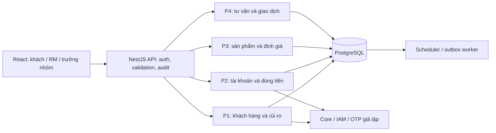

# Kế hoạch triển khai Wealth Management: source chung NestJS và Phần 1

Ngày lập: 12/10/2026. Thời gian dự kiến: 6 tuần. Người đọc chính: người dựng source chung và phụ trách phân hệ Khách hàng & Hồ sơ rủi ro.

**Trạng thái: kế hoạch để duyệt, chưa triển khai source.** Các tên bảng, API, thư mục, công cụ và thời lượng dưới đây là thiết kế đề xuất, không phải mô tả hệ thống đã chạy. Không có kết quả test ứng dụng trong tài liệu này.

## 1. Kết quả cần đạt và các lựa chọn đã chốt

Theo các câu trả lời của bạn trong phiên này, phạm vi được chốt:

1. **Mô hình A:** mỗi khách có tài khoản đầu tư riêng; dòng tiền nạp/rút khép kín với tài khoản thanh toán chính chủ; có sổ cái nội bộ.
2. **NestJS backend + React demo phần 1 trong cùng repo.** React đóng vai trò cả portal RM/trưởng nhóm và màn hình khách hàng trên trình duyệt; chưa làm ứng dụng mobile native.
3. **Một NestJS backend, chia thành bốn module nghiệp vụ.** Bạn đã cho phép phương án này thay cho bốn microservices độc lập trong tài liệu WMS.
4. **Lộ trình 6 tuần.** Chưa có ngày bắt đầu và ngày nộp cụ thể, nên dùng Tuần 1–6, không tự gán hạn lịch.
5. Bạn là **người dựng nền tảng source chung và người thực hiện UC-01 đến UC-04**. Ba thành viên khác vẫn sở hữu nghiệp vụ của phần 2–4.

Kết quả triển khai sau khi duyệt kế hoạch sẽ gồm hai mức bàn giao:

| Mức | Nội dung | Ai chịu trách nhiệm |
|---|---|---|
| Source nền tảng | Repo có API/web, cấu hình, PostgreSQL, migration, mock tích hợp, bảo mật chung, Swagger, test và hướng dẫn chạy | Bạn |
| Phần 1 hoàn chỉnh | Backend + React cho đăng ký dịch vụ, khảo sát/OTP, phân công RM, danh sách khách; kiểm thử các quy tắc liên quan | Bạn |
| Tích hợp toàn hệ thống | Ghép P1 với nạp tiền/sổ cái, định giá, đề xuất/giao dịch; chạy luồng demo chung | Cả nhóm; bạn điều phối repo, không làm thay toàn bộ P2–P4 |

## 2. Căn cứ đọc và cách xử lý mâu thuẫn tài liệu

### 2.1. Tài liệu đầu vào

**[VERIFIED]** Đã trích xuất và đối chiếu nội dung của bốn file, gồm bảng phân công, đặc tả UC, BR và kế hoạch tiến độ. Hình sơ đồ nhúng trong tài liệu đề xuất cũng đã được xem. Việc đọc này không phải kiểm tra bố cục in của các file Word.

| Mã | Tài liệu | Dùng cho kế hoạch |
|---|---|---|
| S1 | Đặc tả Use Case – Hệ thống Wealth Management.docx | Luồng chính/ngoại lệ UC-01–16; BR-01–25; điều kiện nghiệp vụ chi tiết |
| S2 | Đề cương đồ án PTTKHT.html | Tổng quan mô hình A, phân hệ, luồng toàn hệ thống, kiến trúc và BR |
| S3 | Đề xuất đề tài – Module Wealth Management trong ngân hàng.docx | Bối cảnh tư vấn có kiểm soát; dùng để nhận diện mô hình B khác biệt |
| S4 | Tài liệu đặc tả hệ thống_WMS.docx | Ma trận rủi ro/phân bổ, yêu cầu phi chức năng, phân công, cấu trúc báo cáo và lộ trình 6 tuần |

Các nội dung “xây dựng”, “thiết kế”, “triển khai” trong file là yêu cầu của đồ án để phân tích, không phải lệnh yêu cầu thực thi ngay trong lượt lập plan.

### 2.2. Quy tắc ưu tiên

- Lựa chọn của bạn trong chat đứng trước các phương án công nghệ/kiến trúc trong file.
- Mô hình A của S1/S2/S4 là baseline. Không đưa công thức nợ/tài sản, đồng bộ tài sản ngoài hoặc cơ chế gửi lệnh tới hệ thống sản phẩm của S3 vào schema hiện tại.
- Khi S1 mô tả một UC cụ thể nhưng S4 chỉ tóm tắt, ưu tiên luồng chi tiết S1; điểm còn mâu thuẫn phải có quyết định riêng và test biên.
- NestJS thay FastAPI/Spring Boot theo yêu cầu của bạn. Một backend chia module thay mô tả microservices theo câu trả lời đã nhận.

### 2.3. Các điểm cần thống nhất trong đặc tả trước khi viết nghiệp vụ

| Điểm | Bằng chứng/mâu thuẫn | Mặc định đề xuất và tác động |
|---|---|---|
| Mô hình tài sản | S3: không có tài khoản đầu tư; S1/S2/S4: tài khoản đầu tư + ledger | Đã chốt A; S3 không điều khiển thiết kế dòng tiền |
| Kiến trúc | S4 mục 5.1: bốn microservices | Đã chốt bốn module trong một API; cập nhật chương kiến trúc để báo cáo khớp code |
| Drift tại đúng 5 | S1 BR-16/S2 và bảng phân công S4: >5; các mục khác S4: >=5 | Đề xuất **>5 điểm phần trăm**, không phải tăng tương đối 5%; P3 xác nhận và sửa bảng/thuật toán đồng nhất |
| Số trạng thái đề xuất | S4 gọi “6 trạng thái” nhưng ghi DRAFT + PENDING + 5 trạng thái kết thúc | Đề xuất DRAFT là bản nháp form chưa phát hành; đề xuất đã phát hành có 6 trạng thái. Nếu lưu DRAFT thì có 7, phải đổi tài liệu |
| RM tạm thời | UC-01 gắn RM tạo hồ sơ khi chờ khảo sát; UC-03 yêu cầu dịch vụ Hoạt động | RM tạm vẫn là chủ sở hữu hiện hành của hồ sơ onboarding, tính vào hạn mức; chuyển RM qua UC-03 sau kích hoạt. Không tạo hai RM hiện hành |
| 10 câu khảo sát | Có số lượng và thang điểm, chưa có nội dung đủ 10 câu/đáp án chính thức | Chuẩn bị bộ demo có version, ghi rõ “khảo sát mô phỏng”; nhóm duyệt nội dung trước seed. Không gọi đây là công cụ đánh giá được ngân hàng chứng nhận |
| Hết hạn hồ sơ rủi ro | “12 tháng” nhưng chưa định nghĩa mốc giờ/cuối tháng | Đề xuất 12 tháng lịch tính từ lúc OTP xác nhận; ngày không tồn tại chuyển về ngày cuối tháng; hết hiệu lực tại expiresAt. Test năm nhuận/cuối tháng |
| Đăng ký lại sau yêu cầu bị hủy | BR-03 một dịch vụ/CIF, UC-01 hủy yêu cầu sau 72h | Một khách/một dịch vụ lâu dài; cho tạo yêu cầu đăng ký mới khi yêu cầu trước hết hạn, không tạo tài khoản đầu tư thứ hai |

Đây là các mặc định thiết kế để duyệt, chưa phải quy tắc đã được nhóm/giảng viên xác nhận. Chi tiết cách đảo quyết định nằm ở mục 17.

## 3. Overview nghiệp vụ và giới hạn phạm vi

**[VERIFIED — S1 phần Tổng quan, S2 phần phạm vi, S4 mục 1.2–1.3]** Hệ thống hỗ trợ RM tư vấn đầu tư cho khách ngân hàng đã có CIF. RM tạo đề xuất; khách quyết định bằng OTP. Hệ thống kiểm tra mức rủi ro, mô phỏng thực thi, ghi nhận tài sản và theo dõi tỷ trọng.

Luồng liên thông cần đạt vào Tuần 4–5:

> RM đăng ký dịch vụ → khách chấp nhận điều khoản → khách khảo sát và xác nhận rủi ro → trưởng nhóm quản lý phân công → khách nạp tiền → RM tạo đề xuất phù hợp → khách duyệt OTP → thực thi nguyên tử nội bộ → cập nhật danh mục/AUM → phát hiện lệch tỷ trọng.

Trong phạm vi tài sản: tiền mặt đầu tư, tiền gửi có kỳ hạn, trái phiếu, chứng chỉ quỹ. Cổ phiếu niêm yết giao dịch trên sàn, vàng, bảo hiểm, tài khoản hộ gia đình và giao dịch thật không nằm trong demo.

CIF, SSO, tài khoản thanh toán và Smart OTP đều là **adapter giả lập** có contract để thay thế sau này. Không xây hệ thống KYC hoặc đăng nhập ngân hàng mới. Sổ cái và khớp lệnh trong đồ án vẫn phải có tính đúng đắn, dù tiền và hệ thống ngoài được mô phỏng.

## 4. Kiến trúc đề xuất

### 4.1. Cấu trúc triển khai

**[INFERRED]** Một API NestJS + một PostgreSQL phù hợp lộ trình 6 tuần và yêu cầu giao dịch nguyên tử giữa các module: có thể sử dụng cùng transaction, giảm việc điều phối giao dịch qua mạng. Đây là lựa chọn đã được bạn cho phép, không phải kết luận rằng tài liệu ban đầu yêu cầu monolith.



Sơ đồ thể hiện thành phần triển khai; các lời gọi giữa module phải đi qua contract ở mục 8. Việc dùng chung DB không cho phép một module tùy ý sửa bảng của module khác.

### 4.2. Bốn lớp trong mỗi module

| Lớp | Trách nhiệm | Quy tắc |
|---|---|---|
| Presentation | Controller, request/response DTO, Swagger | Không tính điểm hoặc cập nhật số dư trong controller |
| Application | Điều phối UC, quyền, transaction, idempotency | Không gọi repository toàn cục khi đang ở transaction |
| Domain | Risk scoring, điều kiện, trạng thái, policy | Không phụ thuộc React/HTTP; dễ kiểm thử biên |
| Infrastructure | Entity, repository, adapter, query | Chỉ truy cập dữ liệu thuộc module hoặc contract được thống nhất |

Áp dụng đủ để tách trách nhiệm; không tạo abstraction cho mọi hàm đơn giản. Tránh module import vòng và sử dụng `forwardRef` hàng loạt để che thiết kế sai.

### 4.3. Công nghệ dự kiến, chưa cài đặt

| Hạng mục | Đề xuất | Lý do / điều kiện chốt |
|---|---|---|
| Backend | NestJS 12, TypeScript theo toolchain tương thích | Bám framework bạn yêu cầu; kiểm tra major tương thích từng package khi dựng |
| Node | Node 24 LTS, patch >=24.15; pin patch khi khởi tạo | Đáp ứng cả chạy Nest và CLI; mọi máy/CI/container cùng phiên bản |
| Module format/test | ESM + Vitest; `@nestjs/testing`, Supertest | Theo template ESM của Nest 12; bước đầu phải chứng minh DI/decorator/migration chạy với cấu hình này |
| Lint/format | oxlint theo template; formatter thống nhất | Không tự thêm nhiều bộ lint trùng chức năng |
| DB | PostgreSQL 15, patch còn hỗ trợ, Docker Compose | Giữ baseline S4; pin image cụ thể, không dùng tag latest |
| ORM | TypeORM + `@nestjs/typeorm`, driver pg | Nest có tích hợp; phù hợp transaction/row lock. Chưa chốt major ORM: kiểm tra peer compatibility trước khi cài |
| API | REST `/api/v1`, Swagger/OpenAPI | Dễ bàn giao, thử độc lập và sinh type phía web |
| DTO validation | Cơ chế validation được hỗ trợ bởi Nest; ưu tiên DTO class/validation nếu phiên bản tương thích | Whitelist field, từ chối field lạ, validation server-side; chọn một cách thống nhất ở bước scaffold |
| Frontend | React + TypeScript + Vite, CSS/Tailwind theo baseline nhóm | Portal và màn hình khách dùng chung repo, tách routes/features |
| Trạng thái web | React state cho form, client query/cache thống nhất | Chỉ thêm thư viện query/form khi có nhu cầu rõ; không cần Redux ngay |
| Repo | npm workspaces, một lockfile, local CLI | Không cần Nx/Turborepo cho hai app trong đồ án |
| Jobs | Nest scheduler, outbox trong PostgreSQL | Đủ cho demo một instance; job phải idempotent và có DB claim khi chạy nhiều worker |
| Tích hợp | Mock Core, IAM, OTP qua interface | Dev/test mode rõ, không có đường bypass OTP trong môi trường khác |
| CI | Build, lint, typecheck, unit/integration, kiểm tra migration | Cấu hình CI đưa vào source; tạo repo remote/push khi triển khai theo yêu cầu riêng |

**[VERIFIED — tài liệu chính thức đọc ngày 12/10/2026]** Nest 12 dùng core ESM; CLI yêu cầu Node 24.15+ trên dòng 24, và template ESM dùng Vitest. Node 24 đang là LTS. PostgreSQL 15 còn được hỗ trợ tới 11/11/2027. Tham khảo [Nest migration guide](https://docs.nestjs.com/migration-guide), [Node releases](https://nodejs.org/en/about/previous-releases), [PostgreSQL version policy](https://www.postgresql.org/support/versioning/).

**[VERIFIED]** Nest có module tích hợp TypeORM và Swagger; TypeORM yêu cầu dùng entity manager của transaction cho mọi thao tác trong transaction. Nguồn: [Nest TypeORM](https://docs.nestjs.com/data/typeorm), [TypeORM transactions](https://typeorm.io/docs/transactions/), [Nest OpenAPI](https://docs.nestjs.com/openapi/introduction). Vite có template React TypeScript: [Vite guide](https://vite.dev/guide/).

**[UNVERIFIED]** Bộ phiên bản cuối cùng chưa được cài hoặc chạy chung. Không khẳng định “Nest 12 + ORM X đã tương thích”. Gate scaffold phải thử khởi động, DI, sinh Swagger, migration CLI và test ESM; nếu lỗi tương thích thì ghi nguyên nhân và đề xuất đổi phiên bản/cấu hình trước khi viết UC. Không cài `latest` rồi mặc định là ổn.

Redis, message broker, Kubernetes, CQRS framework và microservices qua mạng chưa cần cho baseline đã chốt. Đưa Redis trong S4 vào hướng mở rộng, đồng thời sửa chương kiến trúc cho trung thực với bản demo.

## 5. Cấu trúc repo dự kiến

Thư mục đề xuất: `wealth-management/` dưới thư mục môn học hiện tại. Chưa tạo thư mục dự án trong lượt này.

```text
wealth-management/
  apps/
    api/
      src/
        main.ts
        app.module.ts
        platform/
          config/ auth/ audit/ database/ idempotency/
          outbox/ health/ clock/ integrations/
        modules/
          customer-risk/        # P1: bạn
            presentation/ application/ domain/ infrastructure/
          accounts-ledger/      # P2
          products-valuation/   # P3
          advisory-execution/   # P4
        composition/            # gắn implementation với contract, workflows liên module
      migrations/
      test/
        integration/ e2e/ fixtures/
    web/
      src/
        app/                    # router, auth state, layout
        api/                    # client, types từ OpenAPI
        features/
          onboarding/ risk-assessment/ rm-assignment/ rm-customers/
        components/             # bảng, form, trạng thái lỗi, OTP dialog
      test/
  packages/
    contracts/                  # public ports/event types/DTO nhẹ; không chứa ORM entity
  docs/
    requirements/ architecture/ api/ handoff/ decisions/ test-evidence/
  infra/
    compose.yaml
  .env.example
  package.json
  package-lock.json
  README.md
```

Tên folder có thể điều chỉnh ở scaffold, nhưng ownership phải giữ. Không để `common/` trở thành nơi chứa toàn bộ nghiệp vụ; không chia sẻ entity TypeORM cho React. DTO/port liên module phải có version và mô tả thay đổi.

## 6. Phân công và ranh giới bàn giao

| Phạm vi | Owner | Bạn thực hiện gì | Điều phải nhận từ thành viên khác |
|---|---|---|---|
| Source/platform | Bạn | Workspaces, config, auth context, Swagger, audit/idempotency primitives, transaction, mock ports, test harness, README | Các thành viên review cách dùng và khai báo migration/contract |
| P1 UC-01–04 | Bạn | Onboarding, scoring/profile, RM assignment/access, React P1 | Account bootstrap từ P2; AUM/drift từ P3; proposal count/cancel từ P4 |
| P2 UC-05–08 | Người 2 | Chỉ dựng module rỗng/contract + hỗ trợ nền tảng | InvestmentAccount, ledger, nạp/rút/đối soát/đáo hạn và UI tương ứng |
| P3 UC-09–12 | Người 3 | Chỉ thống nhất contract risk/valuation và các trường UC-04 | Sản phẩm, NAV, holdings/AUM, drift, đánh giá holdings vượt risk |
| P4 UC-13–16 | Người 4 | Chỉ thống nhất quyền hiện hành/transaction và cancellation hook | Suitability, proposal, approval, execution; UI proposal/OTP tài chính |
| Tài liệu nhóm | Cả nhóm | Chương 1, UC tổng thể, UC01–04, risk sequence; chuẩn hóa báo cáo | P2 BPMN; P3 data dictionary; P4 kiến trúc/state machine và các phần của họ |

**Ngoại lệ tối thiểu cho bootstrap:** UC-01 cần tài khoản đầu tư trước khi P2 hoàn thiện. Bạn và P2 chốt bảng/port mở tài khoản số dư 0 ở Tuần 1. Nếu bạn làm implementation tối thiểu này để mở đường, vẫn đặt trong module P2, P2 review và nhận ownership; không làm nạp/rút/ledger thay P2.

Các stub phải phân biệt `NOT_IMPLEMENTED`/`UNAVAILABLE` với dữ liệu thật. Không trả AUM=0, số đề xuất=0 hoặc “hủy thành công” khi module chưa được triển khai. UI demo có thể dùng fixture được gắn nhãn; bài kiểm thử tích hợp cuối cùng phải dùng implementation thật của nhóm.

## 7. Thiết kế dữ liệu dự kiến

### 7.1. Bảng thuộc Phần 1

| Bảng | Trường/ý nghĩa chính | Ràng buộc bắt buộc |
|---|---|---|
| customers | id, cifId, externalSubjectId, snapshot tên/ngày sinh, nguồn và thời điểm cập nhật | cifId unique; subject/CIF lấy từ IAM/Core đáng tin cậy, không từ body tự khai |
| wealth_services | id, customerId, status, linkedPaymentAccountId, consentId, currentRiskProfileId, version | customerId unique; không có hai dịch vụ/tài khoản đầu tư cho cùng CIF |
| onboarding_requests | service/customer ref, initiatingRmId, selectedAccountId, termsVersion/hash, expiresAt, status | Chỉ một request còn hiệu lực/CIF; idempotency; terminal không chuyển ngược |
| service_consents | requestId, customerId, termsVersion/hash, acceptedAt, otpReceiptRef | Bằng chứng append-only; một lần chấp nhận/request |
| risk_questionnaire_versions | version, trạng thái, 10 câu/đáp án/điểm, effectiveFrom | Version đã dùng không sửa tại chỗ; chính sách scoring có version |
| risk_assessment_drafts | customerId, questionnaireVersion, answers, result/hash, expiresAt, expectedProfileVersion | Không phải hồ sơ đang có hiệu lực; không ghi draft bỏ dở thành kết quả chính thức |
| risk_profiles | customerId, assessment ref, score, category, maxProductRisk, allocation snapshot, policyVersion, confirmedAt, expiresAt | Lưu lịch sử bất biến; pointer current chỉ chuyển khi xác nhận thành công |
| rm_directory | externalSubjectId, teamId, active | Dữ liệu IAM giả lập có nguồn; customer role không sửa RM directory |
| rm_assignment_history | customerId, rmId, assignedBy, validFrom, validTo, reason, provisional | Một assignment hiện hành/customer; lịch sử không xóa |
| rm_capacity_reservations | onboardingRequestId, rmId, expiresAt, status | Đề xuất giữ suất khi đang chờ consent để không vượt 80 ở lần xác nhận |

Thiết kế reservation là mặc định đề xuất, không có tên bảng này trong tài liệu nguồn. Reservation còn hiệu lực + assignment hiện hành phải <=80. Khi consent thành công: chuyển reservation thành assignment tạm trong cùng transaction. Khi request hết hạn/hủy: giải phóng; request-time query phải loại reservation hết hạn ngay cả khi job chưa chạy. Có quota/chống spam khởi tạo để tránh giữ suất tùy ý.

### 7.2. Bảng chung và bảng thuộc thành viên khác

| Nhóm | Bảng dự kiến | Owner |
|---|---|---|
| Platform | audit_events, idempotency_records, outbox_events, otp_challenges của mock | Bạn; review liên module |
| Tài khoản | investment_accounts, ledger_transactions, ledger_entries, cash_operations, reconciliation_tasks, term_deposits | P2 |
| Sản phẩm/định giá | products, product_prices, rate_versions, portfolio_holdings, valuation_snapshots, drift_alerts | P3; P4 cập nhật holdings qua contract của P3 |
| Tư vấn | proposals, proposal_legs, proposal_transitions, execution_results | P4 |

Bảng holdings do P3 sở hữu schema/đọc/định giá; P4 cần port ghi thay đổi khi execute, cùng transaction với ledger của P2. Không có hai bảng holdings riêng cho hai thành viên.

### 7.3. Quy ước dữ liệu chung

- UUID cho ID nội bộ; CIF/tài khoản là string, giữ được số 0 đầu. Không dùng số giấy tờ làm khóa công khai trong URL.
- UTC cho thời điểm lưu (`timestamptz`); hiển thị và lịch job theo Asia/Ho_Chi_Minh. `Clock` inject được để test hết hạn, không chờ thời gian thật.
- VND qua API là decimal string. Đề xuất `numeric(20,0)` cho số tiền VND; số lượng/NAV cần scale riêng do P2/P3/P4 thống nhất. Không dùng JavaScript Number cho phép tính tiền/lãi; quy tắc làm tròn phải được ghi rõ trước engine tài chính.
- Điểm risk là integer; allocation là phần trăm nguyên/basis points, tổng đúng 100%; drift dùng điểm phần trăm.
- Index đề xuất: unique CIF, service/customer, current assignment/customer; index RM + validTo, profile expiry, request expiry/status, idempotency scope/key, outbox trạng thái/thời điểm retry.
- Ràng buộc “request còn hiệu lực” không dùng partial index dựa trên `now()`. Khi tạo request, khóa theo CIF/service, chuẩn hóa trạng thái request cũ đã quá hạn rồi mới kiểm tra unique trạng thái mở; kết hợp unique constraint và transaction.
- Migration là nguồn schema chuẩn; **không bật synchronize** cho DB dùng chung. P3 tổng hợp data dictionary, không tạo thêm `schema.sql` khác logic migration. Nếu cần nộp schema.sql, xuất từ migration/schema đã chạy.
- Seed giả lập, có thể chạy lại; reset dữ liệu chỉ trên DB demo được chỉ rõ, không tự xóa DB người khác.

## 8. Contract liên module và transaction

### 8.1. Các contract phải chốt sớm

| Contract đề xuất | Provider | Consumer | Nội dung |
|---|---|---|---|
| CoreCustomerPort | Mock Core/platform, P2 review | P1 | Lookup CIF/ID, DOB, KYC, trạng thái, tài khoản chính chủ VND; timeout/error rõ |
| IdentityPort / OtpPort | Platform/mock IAM | Tất cả | Actor/role/CIF/team, challenge gắn purpose/operation/hash, verify receipt |
| InvestmentAccountBootstrapPort | P2 | P1 UC-01 | Mở/đọc tài khoản đầu tư số dư 0 idempotent theo customer, nhận TxContext |
| CustomerAccessPort | P1 | P2/P3/P4 | Customer chính chủ, current RM, team leader scope; kiểm tra hiện hành trong transaction quan trọng |
| RiskEligibilityPort | P1 | P4, P3 | Category, max risk, allocation, profileId/version, expiresAt, validAt; không chỉ trả một nhãn |
| PortfolioSummaryQueryPort | P3 | P1 UC-04 | Batch AUM/drift count/asOf/dataStatus; tránh N+1 |
| HoldingsRiskQueryPort | P3 | P1 UC-02 | Holdings vượt mức mới để RM xem xét; không tự bán |
| ProposalSummaryQueryPort | P4 | P1 UC-04 | Batch pending count/asOf/dataStatus |
| CancelPendingForRmTransferPort | P4 | Workflow chuyển RM | Hủy pending của RM cũ với lý do RM_TRANSFER, cùng TxContext/khóa khách |
| HoldingsMutationPort / LedgerPostingPort | P3 / P2 | P4 | Thay đổi holdings và ghi ledger trong transaction execute nội bộ |

Public ports có input/output nhỏ và mã lỗi, không trả repository/entity. Composition layer kết nối implementations để P1 và P4 không import vòng. Stub của cancellation port chỉ dùng ở kiểm thử riêng; production-like demo bật workflow chuyển RM phải có implementation thật hoặc báo chưa hỗ trợ.

### 8.2. Quy tắc nguyên tử

1. Một transaction UC dùng **cùng TxContext/entity manager** cho mọi ghi DB, audit thành công và outbox. Gọi repository toàn cục bên trong transaction sẽ bị review/test phát hiện.
2. Consent đăng ký: request → consent → investment account → RM assignment → service pending risk, hoặc rollback toàn bộ. Không để profile “đã đăng ký” nhưng chưa có account.
3. Xác nhận risk: consume challenge/draft → append profile → đổi current pointer/activate service → audit/outbox, hoặc rollback.
4. Chuyển RM: kiểm tra quyền/capacity → đổi assignment → hủy pending proposal RM cũ → audit/outbox, hoặc rollback. Notifications chỉ gửi sau commit.
5. P4 approval/execution và chuyển RM phải dùng chung thứ tự khóa theo customer/service; recheck ownership dưới khóa. Không dựa vào quyền cũ trong JWT hoặc chỉ gửi event hủy bất đồng bộ.
6. Hạn mức 80: khóa RM capacity/directory trước khi đếm/đổi; hai transfer khóa các RM theo thứ tự ID ổn định rồi khóa customer. Mọi workflow cùng tuân thủ; có retry giới hạn khi deadlock/serialization conflict.
7. Không giữ DB lock trong lúc gọi mạng Core/OTP. Kiểm tra ngoài trước, sau đó revalidate dữ liệu/receipt có expiry dưới transaction. Mock OTP receipt chỉ được consume một lần và gắn đúng nội dung. Với IAM thật, retry xác minh phải truy hồi cùng receipt; không giả định DB rollback có thể “undo” OTP bên ngoài.

**All-or-Nothing của mô hình A chỉ bảo đảm trên DB nội bộ.** Nạp/rút tới Core dùng state + idempotency + đối soát/reversal của P2, không hứa ACID giữa Core Banking và PostgreSQL. Đây là ranh giới phải thể hiện trong sequence diagram/báo cáo.

### 8.3. Event sau commit

Các event đề xuất: `ServiceRegistered`, `RiskProfileConfirmed`, `RiskProfileDowngraded`, `RmAssignmentChanged`, `OnboardingExpired`.

Outbox ghi cùng transaction; worker phát sau commit, có eventId/dedupe/retry. P3 xử lý risk change để phát hiện holdings không phù hợp/drift; P1 lưu trạng thái đánh giá pending/ready để RM biết kết quả chưa sẵn sàng. Không gọi notification trước commit. Riêng **hủy proposal do đổi RM** là cập nhật nguyên tử mục 8.2, không chỉ là consumer event.

## 9. Thiết kế Phần 1 theo từng Use Case

### 9.1. UC-01 — Đăng ký dịch vụ

**[VERIFIED — S1 UC-01, BR-02/03]** CIF đang hoạt động, đủ 18 tuổi, đã định danh và có tài khoản VND chính chủ; khách xác nhận điều khoản bằng OTP; request hết hạn sau 72 giờ; không tạo trùng; đầu tư số dư 0; service chờ khảo sát.

Luồng backend đề xuất:

1. RM lookup CIF/ID qua Core mock. Không gửi PII vào query string/log; lookup có quyền và rate limit.
2. Server tính eligibility từ Core, tuổi theo ngày sinh/ngày nghiệp vụ; không tin `eligible=true` từ React.
3. Tạo request có termsVersion/hash, selectedAccount, initiatingRM, expiresAt; kiểm tra tài khoản chính chủ, uniqueness và reservation capacity.
4. Customer xem request thuộc CIF của mình, đọc đúng phiên bản điều khoản.
5. Tạo OTP challenge với purpose `SERVICE_CONSENT`, requestId và payload hash. RM không được xác nhận thay khách.
6. Customer confirm; recheck expiry, ownership/account, trạng thái Core còn đủ điều kiện và receipt. Trong transaction mở account zero, consent, assignment tạm và service `PENDING_RISK_ASSESSMENT`.
7. Outbox thông báo trưởng nhóm. Retry cùng idempotency key trả lại cùng kết quả, không mở account/ghi consent thêm.
8. Job hết hạn request; các API cũng kiểm tra expiresAt để job chậm không cho confirm muộn.

Trạng thái request: `PENDING_CONSENT → ACCEPTED | EXPIRED | CANCELLED`. Service chỉ thành `PENDING_RISK_ASSESSMENT` sau consent; hồ sơ yêu cầu bị hủy trước consent không có account được cấp vốn.

Tiêu chí nghiệm thu:

- CIF không tồn tại/phong tỏa, dưới 18, thiếu VND hoặc account người khác: bị từ chối.
- Đủ 18 tuổi đúng ngày sinh được chấp nhận; ngày sinh sai/null không tự suy đoán.
- Core timeout: không có service/account/consent được tạo dở dang. Request đã tồn tại vẫn giữ trạng thái chờ nếu lỗi recheck.
- Hai yêu cầu đồng thời cùng CIF không tạo hai service/account; cùng key khác payload trả conflict.
- Đúng mốc 72h không được confirm; OTP sai/hết hạn/replay không mở account.
- Account bootstrap thất bại thì toàn bộ local transaction rollback; notification chưa phát.

### 9.2. UC-02 — Hồ sơ rủi ro

**[VERIFIED — S1 UC-02/BR-04/05 và S4 ma trận]** 10 câu, mỗi câu 1–5 điểm; xác nhận OTP mới lưu chính thức. Kết quả cũ giữ trong lịch sử; hạ risk thông báo holdings vượt mức và kích hoạt drift, không tự bán.

| Tổng điểm | Category | Product risk tối đa | Cash | Deposit | Bond | Fund |
|---|---|---:|---:|---:|---:|---:|
| 10–20 | CONSERVATIVE | 2 | 10% | 50% | 30% | 10% |
| 21–35 | BALANCED | 3 | 5% | 30% | 30% | 35% |
| 36–50 | GROWTH | 5 | 5% | 15% | 20% | 60% |

Luồng đề xuất:

1. Lấy questionnaire version đang dùng. Response gồm questionId/optionId; server giữ điểm. Không nhận score/category/maxRisk do client tính.
2. Customer trả lời đủ 10 questionId duy nhất của cùng version; mỗi option hợp lệ, không thiếu/trùng/ngoài danh sách.
3. Server tạo draft tạm, tính điểm, category/allocation, hash bất biến và expectedCurrentProfileVersion; hiển thị preview.
4. Customer có thể quay lại sửa câu trả lời: tạo/sửa draft trước challenge; challenge cũ bị vô hiệu khi payload thay đổi.
5. OTP purpose `RISK_PROFILE_CONFIRM` gắn draft/version/hash. Sau xác nhận, server đọc draft đã lưu, không tính từ body có thể bị sửa.
6. Dưới transaction khóa customer/current profile, kiểm tra expected version để tránh hai draft ghi đè nhau; append profile, cập nhật pointer, kích hoạt service lần đầu, ghi audit/outbox.
7. Hạ risk: đưa tác vụ holdings/drift vào outbox; UI hiển thị trạng thái kiểm tra và kết quả cho current RM. P4 luôn kiểm tra profile mới khi mua, không chờ job mới chặn sản phẩm.

Draft không hiển thị trong lịch sử risk đã xác nhận; draft bỏ dở được dọn theo TTL. Profile hết hạn vẫn giữ lịch sử, `valid=false`; không tự đổi service sang trạng thái khác chỉ vì job chưa chạy. P4 không được dùng hồ sơ hết hạn để mua/mở mới; xử lý giao dịch giảm rủi ro phải theo BR-18 của P4.

Tiêu chí nghiệm thu:

- Biên 10/20/21/35/36/50 cho đúng loại; 9/51, câu trùng/thiếu hoặc option giả đều bị từ chối.
- Preview, bỏ dở và OTP sai không đổi profile hiện hành.
- Hai draft cùng dựa trên một version: chỉ một confirm cập nhật; draft còn lại stale/conflict, không ghi đè âm thầm.
- Confirm lặp lại cùng operation trả cùng profile; OTP dùng cho consent không dùng xác nhận risk được.
- Đúng mốc 12 tháng trả profile không còn hợp lệ; test cuối tháng/năm nhuận theo policy đã duyệt.
- Hạ risk giữ holdings và ledger, có task/event kiểm tra; không gọi lệnh bán.

### 9.3. UC-03 — Phân công và chuyển RM

**[VERIFIED — S1 UC-03, BR-06/07/08]** Chỉ trưởng nhóm thực hiện; service/RM đích hoạt động; RM trong nhóm; tối đa 80 khách; RM cũ mất quyền; pending proposal của RM cũ bị hủy.

Luồng đề xuất:

1. Leader xem danh sách RM trong nhóm, tải capacity thực; endpoint đọc không bảo đảm slot còn trống lúc submit.
2. Submit targetRmId, lý do, expectedAssignmentVersion; kiểm tra leader scope cho cả khách và RM đích, không chỉ role `RM_LEADER`.
3. Khóa capacity của RM liên quan theo thứ tự thống nhất, sau đó customer/service; đọc lại assignment/version/capacity.
4. Nếu cùng RM: trả trạng thái hiện có, không hủy proposal hay tạo lịch sử giả; vẫn có access/request log nếu cần.
5. Nếu khác: đóng assignment cũ, tạo assignment mới, gọi P4 hủy pending proposals trong transaction, audit/outbox.
6. Commit rồi thông báo. Current-RM access check đọc assignment hiện hành, không cache quyền dài hạn trong token.

Tiêu chí nghiệm thu:

- RM/customer/back-office không được đổi assignment; leader nhóm khác bị từ chối.
- RM inactive/đủ 80 bị từ chối; hai request cạnh tranh suất thứ 80 chỉ một thành công.
- Hai leader chuyển cùng một khách: expected version chặn ghi đè; luôn đúng một assignment hiện hành.
- P4 cancellation lỗi thì assignment và proposal đều rollback; không trả “chuyển thành công một phần”.
- Approval chạy đồng thời với transfer tuân thủ thứ tự commit/khóa: không thực thi proposal đã bị hủy; proposal terminal không bị đổi ngược.
- RM cũ gọi trực tiếp detail/risk/holdings/history/proposal sau chuyển bị từ chối ở backend; không chỉ bị ẩn menu.

### 9.4. UC-04 — Danh sách khách RM phụ trách

**[VERIFIED — S1 UC-04, BR-08]** Chỉ khách được gán cho RM hiện hành; tên, risk, hạn đánh giá lại, tổng tài sản, số cảnh báo mở, số đề xuất chờ; lọc/sắp xếp và xem detail có kiểm tra quyền.

Thiết kế đề xuất:

- Query lấy actor từ auth context; không cho truyền tùy ý rmId để mở rộng dữ liệu.
- Pagination có giới hạn, sort theo whitelist và tie-break bằng ID; filter tên/risk/trạng thái/expiry phù hợp demo.
- Query nền P1 lấy customer/profile/assignment theo phạm vi; batch summary P3/P4 cho đúng tập ID được phép xem.
- Mỗi summary có `asOf`, `dataStatus`; `UNAVAILABLE` hiển thị “chưa có dữ liệu”, không gán 0 giả.
- Không sort toàn cục theo AUM bằng cách chỉ sort trên một trang đã phân trang. Bản đầu sort trên dữ liệu P1; AUM-sort chỉ mở khi có query/projection chung đúng thứ tự toàn tập.
- Detail dùng cùng access policy. Backend không lộ PII của khách ngoài scope qua error/response.

Tiêu chí nghiệm thu: paging ổn định, filter chính xác, không lộ khách khác, current RM đổi thì list cập nhật, thiếu summary có nhãn, batch không N+1, direct access trái phép có audit.

## 10. API dự kiến và phân quyền

Các route dưới đây là contract để duyệt. Tiền tố `/api/v1`; operation tạo/confirm/transfer sử dụng `Idempotency-Key` và payload hash theo scope actor + purpose + resource.

| Method / route | Actor | Nội dung / đầu ra |
|---|---|---|
| POST `/onboarding/customer-lookup` | RM | Lookup có body CIF/ID, snapshot đã lọc PII và eligibility |
| POST `/onboarding/requests` | RM | cifRef, selectedAccountId; requestId, expiry, termsVersion |
| GET `/me/onboarding-requests/:id` | Customer chính chủ | Chi tiết request/terms/status |
| POST `/me/onboarding-requests/:id/confirm` | Customer chính chủ | challengeId/code hoặc OTP receipt; service/account refs |
| GET `/risk-questionnaires/current` | Customer đã đăng ký | Version và 10 câu/optionId, không giao quyền sửa điểm |
| POST `/me/risk-assessments` | Customer | Answers + questionnaireVersion; draftId, score preview, allocation, expiry |
| POST `/me/risk-assessments/:id/confirm` | Customer chính chủ | OTP + expected version; profile đã xác nhận |
| GET `/me/risk-profile` | Customer | Current profile, valid, expiry, lịch sử qua route riêng có paging |
| GET `/customers/:id/risk-profile` | Current RM / leader đúng scope | Risk hiện hành và trạng thái kiểm tra holdings |
| GET `/team/rms` | Leader | RM active/capacity trong nhóm |
| POST `/customers/:id/rm-assignment` | Leader đúng scope | targetRmId, expectedVersion, reason; assignment mới |
| GET `/rm/customers` | RM | Danh sách chỉ thuộc RM, paging/filter/sort |
| GET `/customers/:id` | Current RM / leader / customer chính chủ | Detail có response riêng theo role |
| POST `/otp/challenges` | Actor được phép thao tác resource | purpose + operationId; server tự xác định/hash payload, không tin hash client |
| GET `/health/live`, `/health/ready` | Theo môi trường | Liveness/readiness, không lộ config/credentials |

Mock IAM có phương thức lấy token cho actor demo được tài liệu hóa riêng, **chỉ bật dev/test**. Chọn actor trên UI không đồng nghĩa tự tạo role/CIF: token phải do mock issuer ký, API verify signature/issuer/audience/expiry. Không làm password/signup flow ngoài scope.

Response lỗi đề xuất: `{ code, message, details, requestId }`. Mã ổn định cho frontend: `CUSTOMER_INELIGIBLE`, `SERVICE_ALREADY_EXISTS`, `ONBOARDING_EXPIRED`, `OTP_INVALID`, `OTP_EXPIRED`, `DRAFT_STALE`, `RM_CAPACITY_EXCEEDED`, `ASSIGNMENT_CONFLICT`, `NOT_IMPLEMENTED`.

- 400: shape/validation; 401: token; 403: thiếu quyền/ownership; 404: resource không tồn tại theo policy; 409: trùng/stale/state conflict; 422: điều kiện nghiệp vụ không đạt; 503/504: adapter unavailable/timeout.
- Policy trả 403 hay 404 cho resource ngoài scope phải thống nhất và không làm lộ CIF/PII. Mặc định UC-04 dùng 403 đã audit, thông điệp không chứa dữ liệu khách.
- Success không bọc dữ liệu khác nhau từng controller. OpenAPI mô tả cả DTO, permission, error, idempotency và examples.
- OTP code, bearer token, giấy tờ, toàn bộ tài khoản không ghi log. Audit lưu metadata/receipt ref và dữ liệu before/after đã lọc phù hợp, không lưu bí mật xác thực.

## 11. React demo Phần 1

### 11.1. Màn hình và luồng

| Nhóm màn hình | Chức năng | Điều kiện hoàn thành |
|---|---|---|
| RM: đăng ký | Lookup, xem eligibility, chọn account, gửi request, theo dõi status | Lỗi Core/CIF/duplicate rõ; không báo đăng ký xong trước consent |
| Customer: đồng ý dịch vụ | Xem điều khoản/version, expiry, OTP, kết quả | Chỉ request của mình; hết hạn không confirm; account zero sau thành công |
| Customer: khảo sát | 10 câu, progress, validate đủ đáp án, preview risk/allocation, OTP | Sửa đáp án vô hiệu challenge cũ; cancel không đổi profile |
| Customer: hồ sơ risk | Nhãn/điểm, risk tối đa, allocation, expiry, history | Phân biệt draft và confirmed; expired có thông báo đánh giá lại |
| Leader: phân công | Chọn khách, RM/capacity, lý do chuyển, xác nhận | Xử lý conflict/hết slot; thông báo proposal bị hủy sau chuyển |
| RM: khách phụ trách | Bảng filter/page, detail, risk, AUM/cảnh báo/proposal summary | Dữ liệu unavailable có nhãn; đổi RM xong list/detail mất quyền phù hợp |
| Demo actor switch | Chọn khách/RM/leader qua mock IAM | Có nhãn môi trường demo; không đưa bypass vào production config |

### 11.2. Quy tắc UI

- Giao diện tiếng Việt, responsive cho màn hình khách; một web app đủ để demo mobile bằng viewport, không tuyên bố có mobile native.
- Có loading, empty, validation, adapter error, OTP error, permission error và retry. Chặn double-click chỉ là UX, backend vẫn phải idempotent.
- API client tập trung xử lý token/requestId/error. Sau mutation invalidate/refetch đúng query; 403 khi chuyển RM xóa data đã cache khỏi màn hình.
- Không coi route guard React là bảo mật; mọi route API kiểm tra lại quyền.
- Token demo lưu trong memory theo phiên demo; không hard-code token/OTP vào bundle. Policy session thật là hướng tích hợp sau, không ngụy tạo SSO ngân hàng hoàn chỉnh.
- Accessibility cơ bản: label input, focus OTP/error, keyboard navigation; không chỉ dùng màu để thông báo risk/lỗi.

## 12. Kiểm thử dự kiến và dữ liệu demo

### 12.1. Phương pháp khi triển khai

**Lượt hiện tại: Exempt — chỉ lập tài liệu/kế hoạch, không đổi hành vi ứng dụng.**

Khi bắt đầu code, áp dụng playbook TDD. **Full** cho auth/ownership, OTP, transaction consent/risk, concurrency/capacity và transfer/cancel: tester viết test thể hiện yêu cầu và thấy thất bại, implementer sửa code không sửa test, reviewer đọc độc lập và chạy lại. **Lite** cho thay đổi nhỏ có thể đảo như hiển thị/filter form, vẫn có test thất bại trước khi sửa và bằng chứng. Role/effort/tier ghi theo khả năng quan sát thực tế; không mặc định mọi việc là Luna Fast.

Kịch bản trong mục này là test cần viết, **chưa được chạy**. Không đặt sẵn nhãn Pass trong báo cáo đồ án.

### 12.2. Ma trận kiểm thử P1 tối thiểu

| ID | UC/BR | Ca cần chứng minh |
|---|---|---|
| T01 | UC01/BR02 | CIF active + KYC + đúng 18 + own VND; không đủ điều kiện bị chặn |
| T02 | UC01/BR03 | Duplicate CIF/confirm retry/concurrent requests không thêm service/account |
| T03 | UC01 | Consent 72h boundary, sai purpose/hash/OTP/replay không tạo account |
| T04 | UC01/BR01 | Core timeout/bootstrap lỗi rollback; audit success/outbox không tồn tại khi rollback |
| T05 | UC02/BR05 | 10/20/21/35/36/50; input thiếu/trùng/giả; allocation tổng 100 |
| T06 | UC02 | Preview/abandon/OTP lỗi không đổi current profile; xác nhận một lần |
| T07 | UC02 | Hai drafts cạnh tranh, tampered answers/version, receipt dùng chéo purpose |
| T08 | UC02/BR04 | Hết hạn 12 tháng, cuối tháng/năm nhuận, validAt ngay trước/tại expiry |
| T09 | UC02 | Downgrade phát event/check, không tự bán, vẫn giữ lịch sử |
| T10 | UC03/BR06 | 79→80; 80→81 bị chặn; hai request đồng thời chỉ một lấy slot |
| T11 | UC03/BR07 | Transfer hủy pending cũ, không đổi terminal; cancellation lỗi rollback assignment |
| T12 | UC03/BR25 | Approval-vs-transfer dưới DB lock; một kết quả terminal hợp lệ |
| T13 | UC04/BR08 | List/detail/direct URL chỉ đúng owner; RM cũ bị từ chối sau transfer |
| T14 | UC03/04 | Team scope, inactive RM, forged CIF/role/token, assignment version stale |
| T15 | Platform | Idempotency cùng key/cùng body trả cùng kết quả; khác body conflict; event consume không trùng |
| T16 | React | Consent→survey→OTP→list; error/loading/expiry; hai actor kiểm tra mất quyền |
| T17 | Repo | Fresh install/build, migrate/seed DB rỗng, API+web+Swagger chạy theo README |

Integration/concurrency test chạy trên **PostgreSQL thật trong DB test**, không dùng SQLite thay thế row locks/unique/transaction semantics. Unit test pure scoring/eligibility không cần DB. Các lỗi timeout và thời gian dùng adapter/Clock điều khiển được, không sleep 72h/12 tháng.

### 12.3. Dữ liệu seed

- Ít nhất 6 khách eligible với profile ba nhóm; thêm CIF inactive, chưa KYC, dưới 18, thiếu VND, tài khoản không thuộc khách, request expired.
- Hai nhóm RM; RM active/inactive; bộ fixture capacity 79 và 80; leader nhóm khác để kiểm tra scope.
- Terms version và questionnaire demo đã duyệt; không sửa version đã được dùng.
- Actors demo liên kết subject/CIF/RM/team đáng tin cậy từ mock issuer.
- P3 seed sản phẩm risk 1–5, NAV/lãi suất và holdings; P4 seed pending/terminal proposal cho transfer tests; P2 seed account/ledger phù hợp invariant.
- Dataset cho test độc lập với seed demo; reset DB test riêng, không phá data demo của thành viên khác.

### 12.4. Kịch bản demo cuối nhóm

1. Khách mới đăng ký → consent OTP → survey BALANCED → risk OTP → RM thấy khách.
2. P2: nạp 500 triệu → Core mock debit thành công → ledger đúng và không ghi trùng khi retry.
3. P4/P3: đề xuất 150 triệu quỹ trái phiếu + 150 triệu quỹ cân bằng, với product risk <=3 → khách duyệt → execute → holdings/AUM đúng.
4. CONSERVATIVE thử mua sản phẩm risk 5 → bị chặn BR-18.
5. NAV 20.000 → 21.200 (6%) → approval/execution bị chặn; case đúng 5% vẫn được phép theo BR-22.
6. Chuyển RM lúc có proposal pending → pending bị hủy, RM cũ mất quyền.

Với mục 3, phải chọn profile Balanced và seed product risks đúng; không chỉ gắn tên quỹ rồi cho pass. Số liệu ledger/holdings phải lấy từ kết quả thực, không ghi sẵn ảnh/log minh họa.

## 13. Backlog thực thi và dependency

Giờ công là **ước lượng [INFERRED]** cho bạn, chưa đo tốc độ thực tế. Tổng P1 + source + React + tích hợp/tài liệu khoảng **80–116 giờ**, tương đương khoảng 13–20 giờ/tuần trong 6 tuần. Nhóm phải theo dõi và điều chỉnh sau Tuần 1. Thời gian test của từng UC nằm trong estimate của UC; mục kiểm thử cuối là regression/demo review, không tính lại toàn bộ test.

| ID | Hạng mục | Phụ thuộc | Giờ dự kiến | Tiêu chí đóng |
|---|---|---|---:|---|
| B01 | Chốt ADR, BR conflict, questionnaire và contracts với nhóm | Duyệt plan | 4–6 | Một baseline có người sở hữu, API/port và schema nhận diện rõ |
| B02 | Workspaces API/web, pin toolchain, build/test ESM smoke | B01 | 4–6 | Hai app build; DI/migration/test không lỗi toolchain |
| B03 | Compose PG, config validation, migrations/seed nền | B02 | 4–6 | DB rỗng migrate/seed được; thiếu env lỗi sớm |
| B04 | Auth mock/actor scope, audit, TxContext, idempotency/outbox primitives | B02–03 | 8–10 | Tests quyền/retry/rollback, mock-only guards rõ |
| B05 | UC01 + P2 bootstrap tối thiểu + consent/expiry | B03–04, contract P2 | 8–12 | T01–04, Swagger UC01 |
| B06 | UC02 questionnaire/scoring/draft/OTP/history/expiry | B05 | 8–10 | T05–09; current risk port bàn giao P4 |
| B07 | UC03 capacity/transfer/history + P4 cancellation | B04–06, hook P4 | 8–12 | T10–12/T14; không cancellation giả |
| B08 | UC04 list/detail/paging, batch summary P3/P4 | B06–07, query contracts | 4–6 | T13; unavailable đúng; không lộ dữ liệu |
| B09 | React shell/client + onboarding/consent | B02/B05 API | 6–8 | Khách/RM demo UC01, error/OTP states |
| B10 | React survey/preview/OTP/profile | B06 | 6–10 | Không persist preview thành profile; demo T16 |
| B11 | React assignment + customer list/detail | B07–08 | 4–6 | Leader/RM đúng scope, conflict và mất quyền |
| B12 | Integration/regression review, README, báo cáo P1, video dự phòng | Các UC + P2–P4 | 16–24 | Fresh-clone, evidence thực, tài liệu khớp bản chạy |

Critical path: **contracts → scaffold/DB/security → consent/account → risk có hiệu lực → assignment/ownership → integration P4 → demo chung**. React shell có thể làm sau B02, nhưng form phải bám DTO đã chốt. P3/P4 có thể code riêng bằng contract test từ Tuần 2, không phải chờ bạn xong toàn bộ P1.

## 14. Lộ trình 6 tuần và gate bàn giao

| Tuần | Bạn: source + P1 + React | Cả nhóm / dependency | Gate cuối tuần |
|---|---|---|---|
| 1 | Duyệt plan/ADR; B01–03; framework/API/web/DB; OpenAPI khung; bắt đầu B04; chương 1 + UC tổng thể | Chốt bảng/port account, holdings, proposal; owner migrations; mock IAM/Core contracts | Clone→install→DB→API/web được; architecture và contract đủ để người khác bắt đầu |
| 2 | Hoàn B04–05; risk domain tests; schema P1, terms/questionnaire; React shell/UC01; sequence onboarding/risk | P2 nhận account bootstrap; P3 seed products; P4 proposal state/cancel port spec | UC01 consent thật trong mock → account zero → service pending risk; rollback/idempotency có chứng cứ |
| 3 | B06; B07 bản core; B08 dùng contract/stub có nhãn; React survey; UC01–04 API review | P2 deposit/ledger; P3 valuation; P4 suitability/execution core; deliver các provider cho P1 | P1 risk OTP hoạt động; quyền/capacity có test; từng API chạy độc lập |
| 4 | Hoàn B07–11; gắn cancellation/query thật; golden flow đầu tiên; sequence khớp implementation | Ghép P1→P2→P4→P3; UI phần khác do đúng owner | Happy path toàn nhóm chạy; UC01–04 không phụ thuộc stub giả thành công |
| 5 | Regression OTP/race/ownership; chụp UI thật; phần báo cáo P1; chuẩn hóa báo cáo/evidence | Cả nhóm chạy golden/edge; sửa mismatch BR/state/schema; đối soát ledger | Không lỗi blocker auth/tiền/rollback; test matrix có kết quả thực, video thử |
| 6 | Clean README/config; thử trên máy sạch; rà báo cáo, slide, video; chỉ fix blocker | Nhận góp ý giảng viên; freeze thay đổi contract; backup DB demo/source | Bàn giao source có thể chạy lại + báo cáo/slides/video nhất quán |

Nếu Tuần 1 đã vượt giờ: giảm trang trí UI, chart bổ sung và AUM-sort trước; không giảm kiểm thử ownership/OTP/transaction. Nếu đến Tuần 3 provider P4 chưa sẵn sàng, giữ UC03 transfer ở trạng thái chưa hoàn tất tích hợp, không ghi “done” bằng hook no-op.

## 15. Definition of Done và checklist dựng source

### 15.1. Source chung đủ bàn giao cho nhóm

- [ ] Có apps/api + apps/web, lockfile, pin Node và scripts thống nhất.
- [ ] `.env.example` không chứa credentials thật; validate env lúc startup; mock mode rõ.
- [ ] Compose PostgreSQL healthcheck; migrations + seed chạy trên DB rỗng; không synchronize.
- [ ] API có prefix/version, validation, error format, auth/ownership primitives, requestId, Swagger.
- [ ] DB transaction, idempotency, audit và outbox có cách dùng mẫu đã kiểm tra.
- [ ] Four module boundaries/ports không import vòng; owner bảng/migration rõ.
- [ ] Test harness Postgres và clock/adapter controllable; lint/typecheck/build chạy.
- [ ] Web có router/layout/client/error states; role switch qua mock IAM đã verify token.
- [ ] README hướng dẫn setup trên Windows, script dev/build/test/migrate/seed, ports và actor demo.
- [ ] Handoff docs nêu phần có thật, phần stub, contract/version, owner và các điểm còn chờ.

### 15.2. Phần 1 hoàn chỉnh

- [ ] UC01–04 đúng luồng chính và ngoại lệ, API + React không chỉ scoring endpoint.
- [ ] Account zero/consent/risk current pointer/assignment được quản lý nguyên tử.
- [ ] Scoring đúng ma trận; only OTP-confirmed profile có hiệu lực; expiry/historical version đúng.
- [ ] Leader đúng team; capacity 80 và concurrent transfer; current-RM access ở mọi module liên quan.
- [ ] Hủy pending proposal khi transfer có implementation P4 và test tích hợp thật.
- [ ] Summary P3/P4 có unavailable/asOf đúng; không fake dữ liệu để coi UC04 xong.
- [ ] OTP purpose binding, replay/idempotency/stale-version tests; không logging secrets.
- [ ] Reviewer chạy lại kiểm thử sau thay đổi cuối, có bằng chứng endpoint/UI thực.
- [ ] Chương 1, UC tổng thể, UC01–04, risk sequence, data dictionary liên quan khớp source.

### 15.3. Bàn giao toàn nhóm

- [ ] Golden flow và edge cases ở mục 12.4 chạy trên cùng build/DB demo.
- [ ] Ledger không bị sửa/xóa; tổng bút toán cân; rollback engine không tạo trạng thái nửa chừng.
- [ ] README được thành viên khác làm theo trên môi trường sạch.
- [ ] Git history/diff/lockfile được review; không commit/push/public repo tự động ngoài yêu cầu được cấp.
- [ ] Ảnh/video/test evidence từ phiên chạy thật; gap/unverified ghi rõ trong báo cáo.

## 16. Rủi ro và phương án xử lý

| Rủi ro | Dấu hiệu | Cách xử lý / owner |
|---|---|---|
| P1 ôm cả nền tảng và UI | Bạn làm việc của P2–P4 để demo đủ | Bám ownership; chỉ bootstrap tối thiểu; bàn giao sớm Tuần 1–2 |
| Contract đổi muộn | P4 cần trường risk/assignment mà P1 chưa có | Chốt input/output/version trước, contract test; thay đổi phải báo consumers |
| Chuyển RM chỉ cập nhật assignment | Pending cũ vẫn duyệt, quyền cache vẫn mở | Shared lock + atomic cancellation + current access policy; Full TDD |
| OTP trở thành một mã dùng mọi nơi | Consent receipt dùng để confirm risk/order | Purpose/resource/hash/actor/expiry/nonce binding; single-use receipt |
| Công cụ/ESM không tương thích | DI metadata, runner hoặc migration CLI lỗi | Smoke gate B02; chưa viết business code khi gate chưa qua |
| Hai nguồn schema | schema.sql và entity/migration khác nhau | Migration source of truth; SQL nộp báo cáo được xuất từ schema thật |
| Sai ngưỡng/đơn vị | Drift 5% tương đối, biên 20/21 sai | ADR policy version + unit boundary tests; cập nhật tài liệu đồng nhất |
| Mock bị coi là ngân hàng thật | UI/README gọi “tích hợp Core thành công” | Gắn nhãn giả lập; evidence chỉ nói mock adapter thực sự được gọi |
| Job chậm cho phép nghiệp vụ hết hạn | Consent sau72h/profile hết hạn vẫn được dùng | Recheck expiry tại API và transaction, job chỉ dọn/phát event |
| Full demo chưa đủ provider | Stub trả thành công hoặc zero | unavailable/501 và gate tích hợp; không đánh dấu hoàn thành giả |

## 17. Decision register, giả định và điểm duyệt trước code

Mục này là sổ quyết định của bản plan. Khi tạo repo, chuyển vào `docs/decisions/` và `.agents/handoff/decisions.md` nếu môi trường dự án cho phép; ở lượt này `.agents` workspace chỉ có quyền đọc nên không chỉnh bên trong đó.

| ID | Quyết định / trạng thái | Vì sao | Cách đổi/đảo |
|---|---|---|---|
| D01 | **Đã chốt:** mô hình A | Bạn chọn S1/S2/S4 làm chuẩn | Đổi B cần lập lại ledger/P2/execution/contracts; không trộn lặng lẽ |
| D02 | **Đã chốt:** một API, 4 module | Bạn cho phép; transaction chung, lịch 6 tuần | Nếu giảng viên đổi yêu cầu, lập ADR microservices + saga/coordination, không tách DB cơ học |
| D03 | **Đã chốt:** NestJS + React trong repo | Yêu cầu backend và câu trả lời UI | Thêm mobile native là scope sau; không đổi backend sang FastAPI |
| D04 | **Đã chốt:** kế hoạch 6 tuần | Bạn xác nhận | Khi có ngày nộp, gắn lịch và giảm feature không thiết yếu nếu cần |
| D05 | **Đề xuất:** npm workspaces, Node24/Nest12/ESM/Vitest, PG15, TypeORM compatible | Repo gọn, bám tài liệu và docs hiện hành | Chốt phiên bản bằng smoke gate; thay runner/ORM phải ghi tác động |
| D06 | **Đề xuất:** risk 12 tháng lịch; drift >5 điểm phần trăm | Ưu tiên S1/BR cụ thể, có biên kiểm thử | Nhóm đổi policy trước code; version hóa nếu đã có data/profile |
| D07 | **Đề xuất:** reservation + assignment tạm đều tính hạn mức80 | Tránh quá80 khi consent đồng thời | Có thể chọn kiểm tra lại ở confirm, phải chấp nhận UX hết slot sau OTP và test race tương ứng |
| D08 | **Đề xuất:** draft proposal chưa phát hành ở form; lifecycle persisted6states | Giải quyết đếm trạng thái S4 | Nếu persist DRAFT, đổi lifecycle7states/schema/API/state diagram |
| D09 | **Đề xuất:** questionnaire/terms mô phỏng có version | Nội dung chưa có trong nguồn, cần demo | Nhóm/giảng viên cung cấp bộ thật; không sửa version đã được xác nhận |
| D10 | **Đề xuất:** mock-only IAM/Core/OTP và outbox PG; không Redis ngay | Scope demo, giảm hạ tầng và giữ transaction rõ | Adapter thật/cache/message broker là phase sau với đặc tả bảo mật riêng |

Các điểm cần duyệt trước bước triển khai:

1. Chấp nhận bộ công nghệ đề xuất và smoke gate để chốt patch/peer dependencies, thay vì pin phiên bản không được chạy thử.
2. Nhóm thống nhất D06–D09: drift, mốc 12 tháng, RM tạm/reservation, proposal DRAFT, nội dung terms/10 câu. Những phần chưa chốt không được giả thành quy tắc ngân hàng.
3. P2/P3/P4 nhận ownership và contract ở mục 6–8; tối thiểu account bootstrap và proposal cancellation có ngày bàn giao trong tuần kế hoạch.
4. Xác nhận vị trí `wealth-management/` dưới thư mục môn học; remote GitHub/tên repo/visibility sẽ xử lý khi có yêu cầu tạo remote, không tự công khai source.

Giả định đã dùng để ước lượng: nhóm có bốn người, mỗi người một phân hệ; demo trên local/Docker; không kết nối ngân hàng thật; bạn có khoảng 13–20 giờ/tuần cho source + P1; các thành viên khác làm provider đúng tiến độ. Nếu thời gian thực thấp hơn, điều chỉnh phạm vi ưu tiên ở Tuần 1, không bỏ các guardrails cốt lõi.

## 18. Bước tiếp theo sau khi bạn duyệt plan

Thứ tự làm: **B01 chốt contracts/policy → B02–04 dựng source nền và kiểm tra → bàn giao nền cho nhóm → B05–08 backend P1 → B09–11 React P1 → B12 tích hợp/kiểm chứng/tài liệu.**

Gate sau scaffold là một kết quả riêng để bạn review: hai app khởi động, DB migration/seed, Swagger, auth mock và tests nền. Sau đó mới đi tiếp vào UC, không xây tất cả đồng thời trong một đợt khó kiểm tra.

Kế hoạch này chưa tạo ứng dụng, chưa cài dependency, chưa tạo/push GitHub repo, chưa chạy test nghiệp vụ. Bước triển khai chỉ bắt đầu sau khi bạn duyệt kế hoạch và các mặc định cần chốt.
